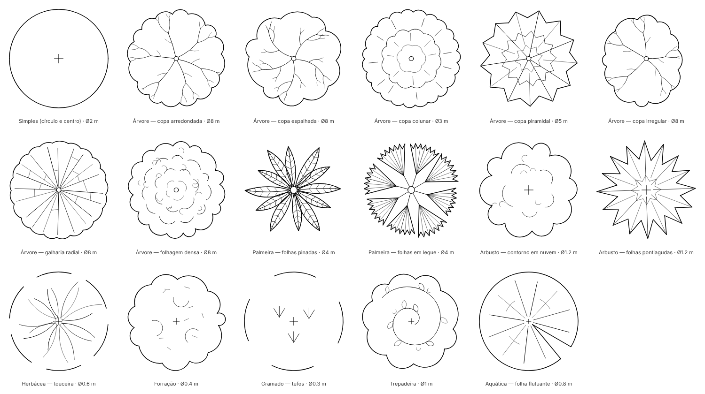
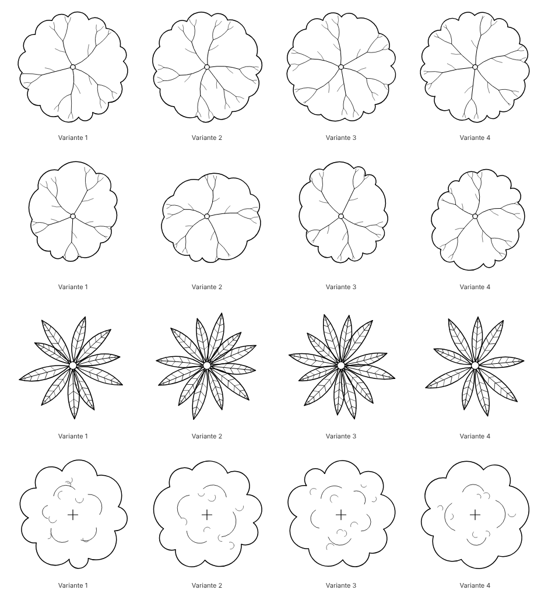

# Viridian

Plugin para **Autodesk Revit 2027** dedicado à documentação técnica **2D** de projetos de paisagismo.

O Viridian não é um editor paralelo ao Revit. Ele é uma camada de inteligência sobre os recursos nativos: famílias da categoria Vegetação, regiões preenchidas, padrões de preenchimento, parâmetros compartilhados, identificadores e tabelas. Tudo o que ele cria continua sendo elemento nativo do Revit, utilizável por qualquer pessoa do projeto.

Fluxo de trabalho: **selecionar espécie → inserir ou delimitar maciço → distribuir → identificar → gerar quantitativos → documentar.**

---

## Instalação

1. Baixe o pacote em [`release/`](release/) e extraia o `.zip`.
2. Feche o Revit e execute **`Instalar.cmd`** (não exige administrador).
3. Abra o Revit 2027: a aba **Viridian** aparece na faixa de opções.

Para remover, execute **`Desinstalar.cmd`**. A biblioteca e as configurações em `%APPDATA%\Viridian` são mantidas.

Antes de usar em projetos reais, siga o [roteiro de testes](docs/ROTEIRO_DE_TESTES.md) em um projeto de teste.

---

## Módulos e ferramentas

A aba **Viridian** tem sete painéis.

### Biblioteca

| Ferramenta | O que faz |
|---|---|
| **Buscar Espécie** | Catálogo botânico com pesquisa sem acentos e filtros projetuais: categoria, origem, forma da copa, altura e copa adultas (faixa), água, luz e crescimento. A ficha mostra o símbolo em cada perfil de escala, a fotografia de referência e os dados técnicos. Dela saem as ações Inserir, Distribuir e Criar maciço. |
| **Cadastro de espécies** | Nova, editar, duplicar e excluir. Campos: nomes científico e popular, família botânica, categoria, origem, alturas (adulta e de implantação), copa, espaçamento, densidade, unidade de fornecimento, preço, crescimento, água, luz, floração, observações, fotografia, estilo do símbolo, variantes gráficas (1 a 4) e hachura de maciço. |
| **Importar Família** | Assistente "Importar símbolo personalizado": verifica categoria, linhas 2D, ponto de inserção e tipos; registra a família na biblioteca e a associa a uma espécie. Famílias de **Vegetação** substituem o símbolo gerado (exemplares BIM); **componentes de detalhe** viram o símbolo gráfico dos maciços (não são contados como plantas). |
| **Atualizar Dados** | Sincroniza o projeto com o catálogo: dados dos tipos, símbolos regerados quando o desenho mudou, maciços e etiquetas. |

O catálogo inicial traz **120 espécies** de uso corrente no paisagismo brasileiro, distribuídas entre as 8 categorias (árvores, palmeiras, arbustos, herbáceas, forrações, gramados, trepadeiras e aquáticas), com nativas e exóticas identificadas e as exóticas invasoras sinalizadas. Os valores (alturas, copas, espaçamentos e densidades) são **referências de projeto** e devem ser conferidos pelo responsável técnico.

### Plantio

| Ferramenta | O que faz |
|---|---|
| **Inserir** | Posiciona exemplares clicando na planta, com variante gráfica (fixa ou aleatória), situação, estágio de implantação e observações. ESC conclui. |
| **Distribuir** | Preenche uma região (região preenchida, piso, toposólido, área, ambiente ou contorno desenhado) nos padrões **triangular, retangular, natural** (disco de Poisson com semente persistente) ou **por densidade**. Controla afastamento das bordas, espaçamento entre linhas, variação de posição, ângulo da malha, quantidade máxima e rotação aleatória. Pode evitar exemplares existentes. Pré-visualização ao vivo antes de inserir. |
| **Plantio Linear** | Distribui ao longo de um eixo desenhado (alamedas, renques e cercas vivas), com deslocamento lateral. |
| **Substituir** | Troca a espécie de exemplares e de maciços **preservando posição, código e dados**. |
| **Editar** | Altera situação (novo, existente, removido, transplantado), estágio, observações e variante gráfica. |

### Maciços

| Ferramenta | O que faz |
|---|---|
| **Criar Maciço** | Região de plantio com três modos: **hachura**, **símbolos** ou **combinado**. O modo é sugerido pela densidade (baixa, média, alta e muito alta, configuráveis). Densidade e espaçamento ficam sempre coerentes; a quantidade é calculada pela área, com reserva de reposição. Espécies vendidas por área (grama em m²) são quantificadas em m². |
| **Editar Maciço** | Altera código, representação, hachura, densidade, distribuição e reserva. |
| **Recalcular** | Depois de alterar o limite de uma região, refaz área, quantidade e símbolos (a mesma semente mantém o mesmo padrão). |

Os dados de cada maciço (código, espécie, área, densidade, espaçamento, quantidade, unidade, padrão, reserva e hachura) ficam gravados na própria região por Extensible Storage.

### Identificação

| Ferramenta | O que faz |
|---|---|
| **Etiquetar** | Seis modelos: código simples, código com nome popular, código com nome científico, código com linha indicadora, código de maciço e etiqueta com área e quantidade. Uma etiqueta por exemplar ou **uma por espécie** com a quantidade ("5 AR-001"). Também aceita os identificadores nativos (tags) de Vegetação do escritório. |
| **Codificar** | Códigos dos exemplares com formato configurável (`{CAT}`, `{ESP}`, `{N}`), na ordem de leitura da prancha; renumeração dos códigos de espécie **por projeto** (AR-001, AR-002…) sem alterar o catálogo. |
| **Atualizar Etiquetas** | Refaz o texto das etiquetas a partir dos dados atuais. |
| **Legenda** | Vista de legenda com símbolo (ou amostra da hachura), código, nomes e quantidade. |

### Quantitativos

| Ferramenta | O que faz |
|---|---|
| **Relatórios** | Por espécie (novos, existentes, transplantados, removidos, em maciços e total), por maciço e de **aquisição** (quantidade de projeto, reserva, compra, unidade, preço e total). |
| **Aquisição** | Abre direto a lista de compra. |
| **Exportar para Excel** | Planilha `.xlsx` com as três abas, formatada (gerada sem bibliotecas externas). |
| **Tabelas Nativas** | Cria as tabelas de vegetação do Revit (por espécie e por exemplar), alimentadas pelos parâmetros compartilhados. |

### Verificação

**Verificar Projeto** lista exemplares sem código, códigos duplicados, famílias não cadastradas, espécies sem identificação botânica, tipos desatualizados em relação ao catálogo, maciços sem densidade, limites de região inválidos, exemplares fora do canteiro, elementos duplicados, maciços duplicados, exemplares e etiquetas órfãos, **conflitos de copa** e **espaçamento insuficiente** (tolerâncias configuráveis). Um clique duplo mostra os elementos no Revit, e há correção automática para códigos, dados desatualizados e registros órfãos.

### Configurações

| Ferramenta | O que faz |
|---|---|
| **Escalas** | Perfis de representação: **Detalhado** (até 1:50), **Intermediário** (até 1:100), **Simplificado** (até 1:250) e **Mínimo** (acima). A dimensão real do símbolo nunca muda; só o detalhamento. É possível fixar o perfil de uma vista. Quando a escala de uma planta muda, o perfil é reaplicado automaticamente. |
| **Configurações** | Pasta da biblioteca (pode ser de rede), modelo de família, faixas de escala, espessura e cor de cada camada, limites de densidade, prefixo e reservas, padrões de distribuição, formato de código, tolerâncias da análise, etiquetas e **hachuras do escritório** (importação de arquivos `.pat`). |
| **Sobre** | Versão e atalhos para as pastas da biblioteca, de configurações e de registros. |

---

## Representação gráfica

Os símbolos 2D são gerados proceduralmente, em **dimensão real**, centrados no ponto de inserção e organizados em seis camadas (subcategorias da Vegetação):

| Camada | Visível em |
|---|---|
| VIR Contorno mínimo | Mínimo |
| VIR Centro | todos |
| VIR Contorno | Detalhado, Intermediário, Simplificado |
| VIR Estrutura essencial | Detalhado, Intermediário, Simplificado |
| VIR Ramificação principal | Detalhado, Intermediário |
| VIR Detalhe | Detalhado |




São 17 estilos: árvore de copa arredondada, espalhada, colunar, piramidal e irregular, galharia radial, folhagem densa, palmeira pinada e em leque, arbusto em nuvem e pontiagudo, herbácea, forração, gramado, trepadeira, aquática e simples. Cada espécie tem uma semente própria (o desenho é sempre o mesmo para a mesma espécie) e até quatro variantes.



As hachuras da biblioteca são padrões de desenho do Revit: pontilhado orgânico, pontilhado denso, traços diagonais, padrão irregular, símbolos repetidos, gramado em tufos, lâmina d'água e hachura simplificada.


---

## Parâmetros BIM

Todos os parâmetros são **compartilhados** (prefixo `VIR_`), vinculados à categoria Vegetação e utilizáveis em tabelas e identificadores nativos.

- **Tipo:** `VIR_CodigoEspecie`, `VIR_NomePopular`, `VIR_NomeCientifico`, `VIR_Categoria`, `VIR_FamiliaBotanica`, `VIR_Origem`, `VIR_AlturaAdulta`, `VIR_CopaAdulta`, `VIR_EspacamentoRecomendado`, `VIR_UnidadeFornecimento`.
- **Instância:** `VIR_CodigoProjeto`, `VIR_Status`, `VIR_VarianteGrafica`, `VIR_EstagioImplantacao`, `VIR_Observacoes`, `VIR_IDMacico`.

Opcionalmente, o código da espécie é gravado também em **Marca de tipo** e o do exemplar em **Marca**.

---

## Onde ficam os arquivos

| Pasta | Conteúdo |
|---|---|
| `%APPDATA%\Viridian\Biblioteca` (configurável) | `Dados\catalogo.json`, famílias geradas por categoria, `Personalizado\` (famílias, símbolos, hachuras, etiquetas) e `Fotos\` |
| `%APPDATA%\Viridian\Config` | `viridian.config.json` e o arquivo de parâmetros compartilhados |
| `%APPDATA%\Viridian\Logs` | registro de erros |

Os arquivos são gravados de forma atômica. Um catálogo corrompido é copiado para backup e recriado a partir do padrão.

---

## Compilar a partir do código

Requisitos: **SDK do .NET 10** (10.0.100 ou superior). O Revit não é necessário para compilar: a API é referenciada pelos pacotes `Nice3point.Revit.Api` 2027, que não são copiados para a saída.

```bash
dotnet test tests/Viridian.Tests -c Release
```

```bash
build/package.sh
```

No Windows, use `build\package.ps1`. O pacote é gerado em `dist/`.

### Estrutura

| Projeto | Responsabilidade |
|---|---|
| `Viridian.Core` | Regras sem dependência do Revit: geometria, gerador de símbolos, distribuição, maciços, escalas, codificação, hachuras, relatórios, verificação e exportação `.xlsx` |
| `Viridian.Library` | Catálogo botânico, catálogo padrão, configurações, pastas e registro de erros |
| `Viridian.Revit` | Integração com a API: parâmetros compartilhados, Extensible Storage, geração de famílias, plantio, maciços, perfis de escala, etiquetas, legenda e tabelas |
| `Viridian.UI` | Janelas WPF |
| `Viridian.Addin` | `IExternalApplication`, faixa de opções, comandos e atualização automática de escala |
| `tests/Viridian.Tests` | Testes automatizados (xUnit) |
| `tools/Viridian.Preview` | Gera pranchas SVG dos símbolos e hachuras para conferência visual |

---

## Fora do escopo

Modelagem 3D de vegetação, renderização, modelos volumétricos, simulação de crescimento, modelagem de terrenos, ferramentas de desenho de pisos e sistemas de tabelas paralelos ao Revit.
