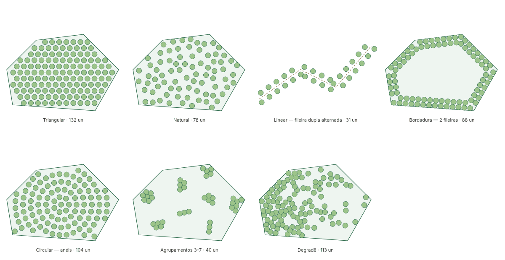
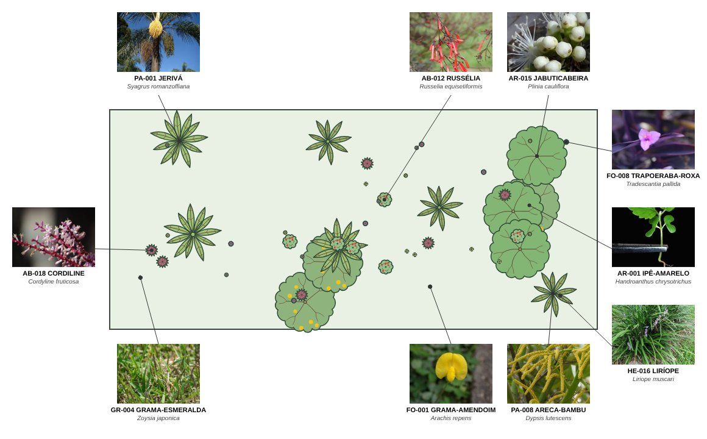
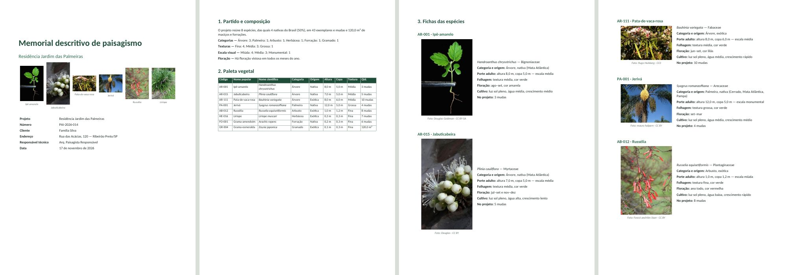
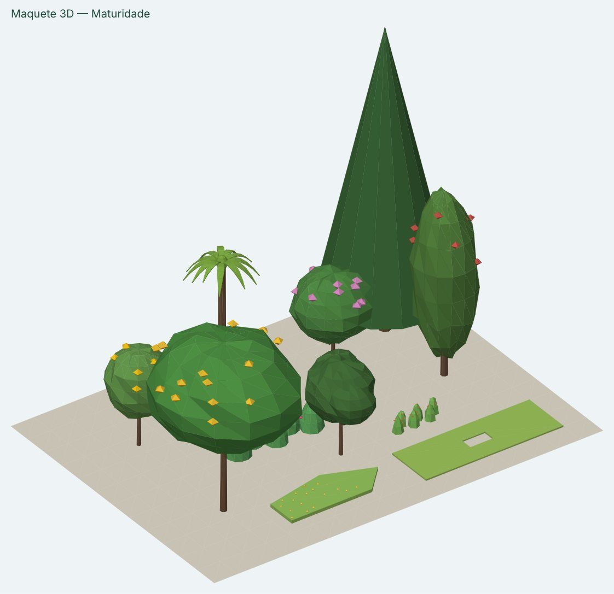
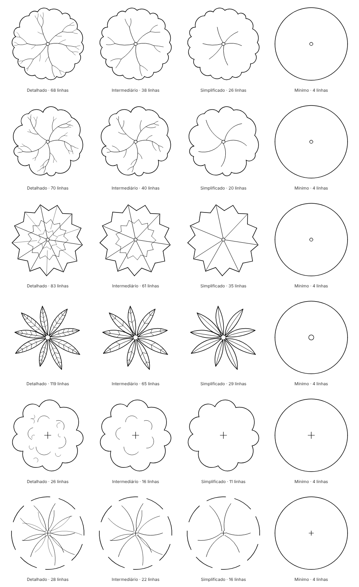
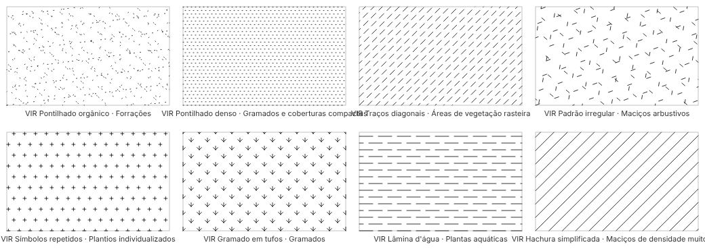

# Viridian

Plugin para **Autodesk Revit 2027** dedicado à documentação técnica **2D** de projetos de paisagismo.

O Viridian não é um editor paralelo ao Revit. Ele é uma camada de inteligência sobre os recursos nativos: famílias da categoria Vegetação, regiões preenchidas, padrões de preenchimento, parâmetros compartilhados, identificadores, tabelas e pranchas. Tudo o que ele cria continua sendo elemento nativo do Revit, utilizável por qualquer pessoa do projeto.

Fluxo de trabalho: **selecionar espécie → inserir ou delimitar maciço → distribuir → identificar → verificar → quantificar, orçar e planejar a manutenção → montar a prancha.**

---

## Instalação

1. Baixe o pacote em [`release/`](release/) e extraia o `.zip`.
2. Feche o Revit e execute **`Instalar.cmd`** (não exige administrador).
3. Abra o Revit 2027: a aba **Viridian** aparece na faixa de opções.

Para remover, execute **`Desinstalar.cmd`**. A biblioteca e as configurações em `%APPDATA%\Viridian` são mantidas.

Antes de usar em projetos reais, siga o [roteiro de testes](docs/ROTEIRO_DE_TESTES.md) em um projeto de teste.

---

## Módulos e ferramentas

A aba **Viridian** tem onze painéis. **Buscar Espécie** é a biblioteca completa (consulta, filtros e cadastro); **Inserir** é a inserção rápida.

### Biblioteca

| Ferramenta | O que faz |
|---|---|
| **Buscar Espécie** | Catálogo botânico com pesquisa sem acentos e filtros projetuais: categoria, origem, forma da copa, altura e copa adultas (faixa), água, luz, crescimento, **bioma**, **mês de floração** e **floração vistosa**. A ficha mostra o símbolo colorido em cada perfil de escala, a **fotografia com autor e licença**, as cores e os dados técnicos. Dela saem as ações Inserir, Distribuir e Criar maciço. |
| **Cadastro de espécies** | Nova, editar, duplicar e excluir. Além dos dados botânicos e de plantio: biomas de ocorrência, **cor da folhagem**, **cor da flor**, fotografia própria e **códigos da tabela de preços** (insumo e serviço de plantio). |
| **Importar Família** | Assistente "Importar símbolo personalizado": verifica categoria, linhas 2D, ponto de inserção e tipos; registra a família na biblioteca e a associa a uma espécie. |
| **Atualizar Dados** | Sincroniza o projeto com o catálogo: dados dos tipos, símbolos regerados quando o desenho ou as cores mudaram, maciços e etiquetas. |

Cada espécie tem **textura** (fina, média ou grossa, sugerida pelo gênero e pela forma e ajustável no cadastro) e **escala visual** (miúda, média ou monumental, calculada pelo porte adulto), usadas na composição dos canteiros.

O catálogo padrão traz **382 espécies** usadas no paisagismo brasileiro: 196 nativas (com os biomas de ocorrência: Amazônia, Caatinga, Cerrado, Mata Atlântica, Pampa e Pantanal) e 186 exóticas comuns no Brasil, com as **invasoras sinalizadas**. São 141 árvores, 36 palmeiras, 53 arbustos, 58 herbáceas, 31 forrações, 8 gramados, 32 trepadeiras e 23 aquáticas. **380 têm fotografia** (iNaturalist, somente licenças CC0, CC BY e CC BY-SA, com os créditos na ficha e em `Fotos\CREDITOS.txt`). Alturas, copas, espaçamentos e densidades são **referências de projeto** e devem ser conferidos pelo responsável técnico.

### Plantio

| Ferramenta | O que faz |
|---|---|
| **Inserir** | Inserção rápida em **uma única janela**: pesquisa com as espécies usadas por último no topo, símbolo colorido, foto e opções (variante, situação, estágio e observações). Depois, o símbolo colorido acompanha o cursor (prévia nativa do Revit); ESC conclui. Distribuir, Plantio Linear, Criar Maciço e Substituir usam o mesmo seletor rápido, com acesso à biblioteca completa. |
| **Distribuir** | Preenche uma região (região preenchida, piso, toposólido, área, ambiente ou contorno desenhado) nos padrões **triangular, retangular, natural, por densidade, bordadura** (fileiras que acompanham o contorno, inclusive curvas e recortes), **anéis concêntricos**, **agrupamentos** (manchas ímpares de 3, 5, 7 plantas) e **degradê** (rareando de um lado para o outro). Cada padrão mostra só as opções que fazem sentido para ele. Pode evitar exemplares existentes. Pré-visualização colorida ao vivo. |
| **Plantio Linear** | Eixo por **linha reta** (dois cliques), **polilinha**, **círculo** (centro e raio) ou **linhas, arcos, paredes e redes existentes** (também aceita a seleção feita antes do comando). Define por espaçamento ou por quantidade, com plantas nas duas pontas, a partir do início ou centralizadas; até cinco fileiras paralelas ou alternadas (zigue-zague); deslocamento lateral e eixos fechados. |
| **Substituir** | Troca a espécie de exemplares e de maciços **preservando posição, código e dados**. |
| **Editar** | Altera situação (novo, existente, removido, transplantado), estágio, observações e variante gráfica. |



### Maciços

| Ferramenta | O que faz |
|---|---|
| **Criar Maciço** | Região de plantio com três modos: **hachura**, **símbolos** ou **combinado**, sugeridos pela densidade. A região é pintada com a cor da espécie (fundo claro e hachura mais escura). A quantidade é calculada pela área, com reserva de reposição; espécies vendidas por área são quantificadas em m². |
| **Editar Maciço** | Altera código, representação, hachura, densidade, distribuição e reserva. |
| **Recalcular** | Depois de alterar o limite de uma região, refaz área, quantidade e símbolos (a mesma semente mantém o mesmo padrão). |

### Identificação

| Ferramenta | O que faz |
|---|---|
| **Etiquetar** | Seis modelos de etiqueta, uma por exemplar ou **uma por espécie** com a quantidade. As etiquetas **procuram uma posição livre** ao redor da planta, sem sobrepor outros textos, e ganham linha indicadora quando precisam se afastar. Também aceita os identificadores nativos de Vegetação do escritório. |
| **Codificar** | Códigos dos exemplares com formato configurável e renumeração dos códigos de espécie **por projeto**. |
| **Atualizar Etiquetas** | Refaz o texto das etiquetas a partir dos dados atuais. |
| **Legenda** | Vista de legenda com o símbolo colorido (ou a amostra da hachura na cor da espécie), **fotografia**, código, nomes e quantidade. |
| **Quadro de Fotos** | Coloca ao redor da planta a **fotografia de cada espécie**, com código e nome, ligada por linha a um exemplar, como nas pranchas de paisagismo ilustradas. As posições evitam linhas cruzadas; com região de corte ativa, o recorte é ampliado. |



### Quantitativos

| Ferramenta | O que faz |
|---|---|
| **Relatórios** | Por espécie, por maciço, de **aquisição**, **orçamento** e **manutenção**, com exportação para Excel (`.xlsx` com todas as abas). |
| **Aquisição** | Lista de compra com reserva de reposição, unidade comercial e preço. |
| **Orçamento** | Fornecimento e plantio a partir de uma **tabela de preços importada** pelo escritório (SINAPI, tabela municipal ou própria, em `.xlsx` ou `.csv`; o cabeçalho é localizado automaticamente). Vincula códigos de insumo e de serviço às espécies (busca na tabela), aplica o **BDI** e aponta unidades divergentes e códigos não encontrados. O Viridian não traz preços: os valores vêm sempre da tabela do usuário ou do cadastro. |
| **Manutenção** | Cronograma por espécie e mês: **rega de implantação** (pelo mês do plantio) e na estiagem (pela estação seca da região), **adubação** (inclusive de pré-floração), **podas logo após a floração**, poda de formação, limpeza de palmeiras, corte de gramados (quinzenal nas chuvas, mensal na seca), coroamento, tutoramento e **reposição de falhas** aos 30 e 90 dias com a reserva prevista. |

### Documentação

| Ferramenta | O que faz |
|---|---|
| **Prancha Automática** | Cria a prancha com a planta ativa (opcionalmente com o quadro de fotos), a legenda com fotos e a tabela de quantitativos, diagramadas sobre o carimbo escolhido: planta à esquerda, legenda e tabela na coluna da direita, canto do carimbo livre, margens da NBR 10068. Reduz a escala para a planta caber e usa uma vista dependente quando a planta já está em outra prancha. |
| **Exportar CAD** | Exporta vistas e pranchas para **DWG** (2007 a 2018, em metros ou milímetros, com cores e preenchimentos da vista, opção de coordenadas compartilhadas) e gera a **biblioteca de blocos DXF** dos símbolos (espécies do projeto ou catálogo inteiro), com camadas por nível de detalhe, preenchimento e floração. |
| **Tabelas Nativas** | Cria as tabelas de vegetação do Revit (por espécie e por exemplar). |

### Composição

| Ferramenta | O que faz |
|---|---|
| **Ateliê de Paletas** | Escolha de espécies pela cor: harmonias **monocromática, análoga, complementar e tríade** a partir de um matiz, ou **paletas prontas** (quente tropical, branco e verde, rosa e lilás, azul e roxo, entre outras). Filtra por categoria, somente nativas, somente com floração vistosa e **meses de floração** desejados. As espécies aparecem em ordem de afinidade com a cor da flor e da folhagem, com símbolo e foto; dali é possível inserir ou distribuir. Funciona mesmo sem projeto aberto. |
| **Verificar Canteiro** | Escolha a região: o canteiro é avaliado por **equilíbrio** (espécie dominante), **diversidade**, **contraste de texturas**, **escala** em relação às dimensões do canteiro, **sub-bosque** sob palmeiras e árvores, e **meses sem floração vistosa**. As observações são recomendações de composição, com clique duplo para ver as plantas; os limites ficam em Configurações > Composição. |
| **Calendário de Floração** | Quadro de **janeiro a dezembro** com o que floresce no projeto, cada mês pintado na cor da flor, a quantidade de cada espécie e os **meses sem floração** destacados. É criado como vista de desenho, pronta para a prancha. |


### Detalhamento

| Ferramenta | O que faz |
|---|---|
| **Memorial Ilustrado** | Memorial descritivo em **Word editável** (`.docx`): capa com mosaico de fotos, partido paisagístico (texto-base para completar), paleta vegetal, **ficha de cada espécie com foto**, calendário de floração, especificações de plantio, manutenção e créditos das fotografias. Os dados do projeto vêm de Gerenciar > Informações do projeto. |
| **Detalhe de Plantio** | Detalhes em corte de **cova de árvore** (com tutor e amarrio), **berço de palmeira**, **cova de arbusto**, **canteiro de forração** e **gramado**, com cotas, chamadas e as **notas de especificação** de cada espécie. As dimensões da cova seguem a altura da muda. |
| **Corte Esquemático** | Desenhe uma linha na planta: as plantas cortadas (e próximas à linha) aparecem em **silhueta** com altura e copa reais, conforme o tipo (árvore pela forma da copa, palmeira, arbusto, forração), com régua de alturas e códigos. Pode mostrar a vegetação **no plantio, aos 3 ou 6 anos ou na maturidade**. |
| **Crescimento 2D** | O mesmo canteiro em quatro quadros, **no plantio, aos 3 anos, aos 6 anos e na maturidade**, com as copas estimadas pela taxa de crescimento de cada espécie: mostra quando o canteiro fecha e onde haverá sobreposição. |

As notas de especificação são montadas a partir de **modelos editáveis** (Configurações > Composição): um modelo geral e um por tipo de plantio (árvore, palmeira, arbusto, forração, gramado), com campos como `{nome_popular}`, `{altura_muda}`, `{cova_largura}`, `{cova_profundidade}`, `{camada_solo}`, `{tutor}` e `{espacamento}`.

Os valores de cova, camada de solo, tutoramento e crescimento são **referências de projeto** e devem ser conferidos pelo responsável técnico.




### Maquete 3D

| Ferramenta | O que faz |
|---|---|
| **Maquete 3D** | Cria a vista "Viridian - Maquete 3D" com a vegetação **em volume**: árvores com tronco e copa conforme a forma (arredondada, espalhada, colunar, cônica, irregular), palmeiras com estipe e folhas arqueadas, arbustos e touceiras, **maciços baixos e gramados como volume** que segue o contorno (inclusive recortes), e **manchas de flor** nas espécies de floração vistosa, tudo nas cores das espécies. Pode ser do **projeto inteiro** ou de **uma região** da planta (a vista é recortada em torno dela), **no plantio, aos 3 ou 6 anos ou na maturidade**. As plantas são **assentadas sobre o terreno** (toposólido ou superfície topográfica, também em vínculos); em lajes, coberturas e pisos, ficam sobre eles. A vista abre com sombreamento e sombras. |
| **Atualizar Maquete** | Refaz a maquete com o mesmo recorte e a mesma fase, depois de mudanças no plantio. |
| **Remover Maquete** | Apaga a maquete, os materiais criados para ela e a vista (quando não está em uma prancha). |

A maquete é **opcional e não altera o que já existe**: as formas são geradas sem família (formas diretas, categoria Entorno), com representação vazia em planta, de modo que **as plantas baixas continuam mostrando só os símbolos 2D**, e não entram nos quantitativos nem nas tabelas. Elas aparecem nas vistas 3D, nos cortes e nas elevações; em projetos com subprojetos, ficam no subprojeto "VIR Maquete 3D", oculto por padrão nas outras vistas. A maquete não acompanha as mudanças sozinha: depois de alterar o plantio, use **Atualizar Maquete**. Os volumes são aproximações para visualização, sem parâmetros.



### Verificação

| Ferramenta | O que faz |
|---|---|
| **Verificar Projeto** | Exemplares sem código, códigos duplicados, famílias não cadastradas, tipos desatualizados, maciços sem densidade, limites inválidos, exemplares fora do canteiro, duplicados, órfãos, **conflitos de copa**, **espaçamento insuficiente** e **interferências**. Clique duplo mostra os elementos; há correção automática para códigos, dados e registros órfãos. |
| **Interferências** | Distância do tronco a **tubulações, eletrodutos, dutos, eletrocalhas, postes e luminárias, equipamentos elétricos e paredes**, por tipo de planta (árvore, palmeira, arbusto), considerando o diâmetro das redes e a copa adulta junto às fachadas; aponta também plantas **sobre pisos sem berço**. Lê o projeto e os **modelos vinculados** (instalações, arquitetura, infraestrutura). As distâncias são editáveis. |

### Configurações

| Ferramenta | O que faz |
|---|---|
| **Escalas** | Perfis de representação **Detalhado**, **Intermediário**, **Simplificado** e **Mínimo**. A dimensão real do símbolo nunca muda; só o detalhamento. |
| **Configurações** | Biblioteca, escalas, padrão gráfico das linhas, **cores** (preenchimento sólido ou reticulado, clareamento, floração, maciços coloridos e cor-base de cada categoria, com pré-visualização), **interferências**, **composição** (limites das regras, modelos das notas de especificação e opções da maquete 3D), **acessibilidade**, maciços, plantio, codificação, análise, etiquetas e hachuras do escritório. |
| **Sobre** | Versão e atalhos para as pastas da biblioteca, de configurações e de registros. |

---

## Representação gráfica

Os símbolos 2D são gerados proceduralmente, em **dimensão real**, centrados no ponto de inserção e organizados em camadas (subcategorias da Vegetação), ligadas e desligadas conforme a escala da vista:

| Camada | Visível em |
|---|---|
| VIR Contorno mínimo | Mínimo |
| VIR Centro | todos |
| VIR Contorno | Detalhado, Intermediário, Simplificado |
| VIR Estrutura essencial | Detalhado, Intermediário, Simplificado |
| VIR Ramificação principal | Detalhado, Intermediário |
| VIR Detalhe | Detalhado |
| VIR Preenchimento (copa colorida) | Detalhado, Intermediário, Simplificado |
| VIR Floração (manchas de flor) | Detalhado, Intermediário |

### Cores

Cada espécie recebe a cor da sua folhagem (ou uma variação suave e estável da cor-base da categoria) e, quando floresce de forma vistosa, manchas na cor da flor. As linhas usam tons de verde-escuro e marrom, que leem bem sobre as copas e também em impressão em preto e branco. O preenchimento pode ser **sólido**, **reticulado** ou desligado.




São 17 estilos de símbolo, cada espécie com semente própria (o desenho é sempre o mesmo para a mesma espécie) e até quatro variantes.




---

## Acessibilidade

- Interface inteiramente em português, com números na notação brasileira.
- **Tamanho do texto e dos controles** de 100% a 150% (Configurações > Acessibilidade).
- **Alto contraste** próprio, e o alto contraste do Windows é seguido automaticamente.
- Cores do tema verificadas por teste automatizado contra o contraste mínimo da **WCAG 2.1 (AA)**.
- Navegação por teclado: Tab entre os campos, Alt + letra sublinhada, Enter confirma e Esc cancela; campos com nomes para leitores de tela.

---

## Parâmetros BIM

Todos os parâmetros são **compartilhados** (prefixo `VIR_`), vinculados à categoria Vegetação e utilizáveis em tabelas e identificadores nativos.

- **Tipo:** `VIR_CodigoEspecie`, `VIR_NomePopular`, `VIR_NomeCientifico`, `VIR_Categoria`, `VIR_FamiliaBotanica`, `VIR_Origem`, `VIR_AlturaAdulta`, `VIR_CopaAdulta`, `VIR_EspacamentoRecomendado`, `VIR_UnidadeFornecimento`.
- **Instância:** `VIR_CodigoProjeto`, `VIR_Status`, `VIR_VarianteGrafica`, `VIR_EstagioImplantacao`, `VIR_Observacoes`, `VIR_IDMacico`.

Opcionalmente, o código da espécie é gravado também em **Marca de tipo** e o do exemplar em **Marca**.

---

## Onde ficam os arquivos

| Pasta | Conteúdo |
|---|---|
| `%APPDATA%\Viridian\Biblioteca` (configurável) | `Dados\catalogo.json`, `Dados\tabela-precos.json` (tabela importada), famílias geradas por categoria, `Personalizado\` (famílias, símbolos, hachuras, etiquetas) e `Fotos\` (fotos próprias do escritório) |
| `%APPDATA%\Autodesk\Revit\Addins\2027\Viridian\Fotos` | fotografias do catálogo padrão e `CREDITOS.txt` |
| `%APPDATA%\Viridian\Config` | `viridian.config.json` e o arquivo de parâmetros compartilhados |
| `%APPDATA%\Viridian\Logs` | registro de erros |

Os arquivos são gravados de forma atômica. Um catálogo corrompido é copiado para backup e recriado a partir do padrão. Ao atualizar o plugin, as espécies do catálogo padrão que o escritório não editou são atualizadas, e as editadas recebem apenas os dados novos (biomas, cores e foto), preservando o que foi alterado.

---

## Compilar a partir do código

Requisitos: **SDK do .NET 10** (10.0.100 ou superior). O Revit não é necessário para compilar: a API é referenciada pelos pacotes `Nice3point.Revit.Api` 2027, que não são copiados para a saída.

```bash
dotnet test tests/Viridian.Tests -c Release
```

```bash
build/package.sh
```

No Windows, use `build\package.ps1`. O pacote é gerado em `dist/`.

### Estrutura

| Projeto | Responsabilidade |
|---|---|
| `Viridian.Core` | Regras sem dependência do Revit: geometria, símbolos e cores, distribuição e eixos de plantio, maciços, escalas, codificação, hachuras, relatórios, orçamento e leitura de tabelas de preços, cronograma de manutenção, interferências, diagramação de pranchas, verificação, composição (paletas, texturas, calendário de floração, regras de canteiro), detalhamento (detalhes de plantio, cortes, crescimento, especificações), malhas da maquete 3D (formas das plantas, triangulação dos maciços), memorial e exportação `.xlsx`, `.docx` e `.dxf` |
| `Viridian.Library` | Catálogo botânico, catálogo padrão (dados e créditos das fotos), tabela de preços, configurações, pastas e registro de erros |
| `Viridian.Revit` | Integração com a API: parâmetros compartilhados, Extensible Storage, famílias com copa colorida, plantio, eixos, maciços, perfis de escala, etiquetas, legenda, tabelas, pranchas, exportação DWG, leitura de redes nos vínculos, desenho das vistas de detalhamento e maquete 3D (formas diretas, materiais, terreno) |
| `Viridian.UI` | Janelas WPF |
| `Viridian.Addin` | `IExternalApplication`, faixa de opções, comandos e atualização automática de escala |
| `tests/Viridian.Tests` | Testes automatizados (xUnit) |
| `tools/Viridian.Preview` | Gera pranchas SVG dos símbolos, cores, distribuições, hachuras, detalhamentos e da maquete 3D, e um memorial de exemplo, para conferência visual |

---

## Fora do escopo

Famílias 3D paramétricas de vegetação, renderização fotorrealista, levantamento arbóreo, cálculo de volume de solo, modelagem de terrenos, ferramentas de desenho de pisos e sistemas de tabelas paralelos ao Revit.
