# Viridian

Plugin para **Autodesk Revit 2027** dedicado à documentação técnica **2D** de projetos de paisagismo.

O Viridian não é um editor paralelo ao Revit. Ele é uma camada de inteligência sobre os recursos nativos: famílias da categoria Vegetação, regiões preenchidas, padrões de preenchimento, parâmetros compartilhados, identificadores, tabelas e pranchas. Tudo o que ele cria continua sendo elemento nativo do Revit, utilizável por qualquer pessoa do projeto.

Fluxo de trabalho: **selecionar espécie → inserir ou delimitar maciço → distribuir → identificar → verificar → quantificar, orçar e planejar a manutenção → montar a prancha.**

---

## Instalação

1. Baixe o pacote em [`release/`](release/) e extraia o `.zip`.
2. Feche o Revit e execute **`Instalar.cmd`** (não exige administrador).
3. Abra o Revit 2027: a aba **Viridian** aparece na faixa de opções.

Para remover, execute **`Desinstalar.cmd`**. A biblioteca e as configurações em `%APPDATA%\Viridian` são mantidas.

Antes de usar em projetos reais, siga o [roteiro de testes](docs/ROTEIRO_DE_TESTES.md) em um projeto de teste.

---

## Módulos e ferramentas

A aba **Viridian** tem nove painéis, só com botões grandes; ferramentas da mesma família ficam juntas num **menu** (setinha embaixo do botão):

| Painel | Botões (e o que fica no menu) |
|---|---|
| Biblioteca | Buscar Espécie · **Cadastro** (Nova Vegetação, Importar Família, Atualizar Dados) |
| Plantio | Inserir · Distribuir · Plantio Linear · **Alterar Plantio** (Substituir, Editar) |
| Maciços e Canteiros | Criar Maciço · **Ajustar Maciço** (Editar Maciço, Ajustar Contorno, Recalcular) · Compor Canteiro · **Modelos de Canteiro** (Salvar Canteiro, Inserir Modelo) |
| Composição | Ateliê de Paletas · Floração · **Estudo Solar** (e Indicar Norte) · Verificar Canteiro |
| Pisos e Drenagem | **Gerador de Pisos** (e Pedras e Coberturas) · Jardim de Chuva |
| Documentação | **Etiquetar** (Atualizar Etiquetas, Codificar) · **Legenda** (Quadro de Fotos) · Prancha Automática · **Quadros e Exportação** (Quadro de Especificação, Tabelas Nativas, Exportar CAD) · **Detalhes e Memorial** (Memorial Ilustrado, Detalhe de Plantio, Corte Esquemático, Crescimento 2D) |
| Quantitativos e Verificação | **Relatórios** (Aquisição, Orçamento, Manutenção) · Verificar Projeto · Interferências |
| Maquete 3D | **Maquete 3D** (Atualizar, Remover) · Vegetação nas Pranchas |
| Configurações | **Configurar** (Configurações, Escalas, Sobre, Diagnóstico 3D) |

Nos botões com menu, clicar no desenho do botão executa a ação principal e a setinha mostra as demais. **Buscar Espécie** é a biblioteca completa (consulta, filtros e cadastro); **Inserir** é a inserção rápida. As seções abaixo descrevem as ferramentas por assunto.

### Biblioteca

| Ferramenta | O que faz |
|---|---|
| **Buscar Espécie** | Catálogo botânico com pesquisa sem acentos e filtros projetuais: categoria, origem, forma da copa, altura e copa adultas (faixa), água, luz, crescimento, **bioma**, **mês de floração** e **floração vistosa**. A ficha mostra o símbolo colorido em cada perfil de escala, a **fotografia com autor e licença**, as cores e os dados técnicos. A foto pode ser trocada ali mesmo: **Trocar foto** (arquivo), **Colar imagem** (copiada do navegador) ou arrastando o arquivo para cima da foto; **Foto do catálogo** volta à original. A foto escolhida fica na pasta de fotos da biblioteca do escritório e não é substituída em atualizações do plugin. Dela saem as ações Inserir, Distribuir e Criar maciço. **Planilha** exporta as espécies da lista para o Excel (31 colunas: nomes, porte, plantio, preço, água, seca, encharcamento, floração, cores, frutos, folhagem e observações) e importa a planilha editada: mostra o que muda antes de gravar, casa as linhas pelo identificador ou pelo nome científico, célula vazia mantém o valor e linha sem identificador vira espécie nova; valores inválidos são listados e ignorados. |
| **Nova Vegetação** | Cria uma vegetação própria do zero, com ou sem projeto aberto: nomes, categoria, porte, espaçamento, cores da folhagem e da flor, floração, símbolo e fotografia. Ela entra na biblioteca do escritório como as do catálogo e, com um projeto aberto, já pode ser inserida, distribuída ou virar maciço. |
| **Cadastro de espécies** | Nova, editar, duplicar e excluir. Além dos dados botânicos e de plantio: biomas de ocorrência, **cor da folhagem**, **cor da flor**, **cor do fruto**, fotografia própria e **códigos da tabela de preços** (insumo e serviço de plantio). As cores são escolhidas **com poucos cliques**: clique na amostra e escolha numa paleta com nomes (flores, folhagens, frutos), nas cores usadas por último ou com o **conta-gotas na foto da espécie**; o código (#RRGGBB) continua disponível. O mesmo seletor vale para as cores das pedras. |
| **Importar Família** | Assistente "Importar símbolo personalizado": verifica categoria, linhas 2D, ponto de inserção e tipos; registra a família na biblioteca e a associa a uma espécie. |
| **Atualizar Dados** | Sincroniza o projeto com o catálogo: dados dos tipos, símbolos regerados quando o desenho ou as cores mudaram, maciços e etiquetas. |

Cada espécie tem **textura** (fina, média ou grossa, sugerida pelo gênero e pela forma e ajustável no cadastro) e **escala visual** (miúda, média ou monumental, calculada pelo porte adulto), usadas na composição dos canteiros, e, separadas da necessidade de rega, a **tolerância à seca** e a **tolerância ao encharcamento** (baixa, média ou alta). Pedir muita água não quer dizer tolerar solo encharcado: as duas tolerâncias vêm cadastradas no catálogo padrão para as espécies de comportamento bem conhecido (plantas de brejo e beira d'água, suculentas, espécies de cerrado e caatinga, espécies sensíveis à seca) e ficam **não informadas** nas demais; só as aquáticas são presumidas tolerantes ao encharcamento. O jardim de chuva sugere para o fundo apenas espécies com a tolerância cadastrada.

O catálogo padrão traz **382 espécies** usadas no paisagismo brasileiro: 196 nativas (com os biomas de ocorrência: Amazônia, Caatinga, Cerrado, Mata Atlântica, Pampa e Pantanal) e 186 exóticas comuns no Brasil, com as **invasoras sinalizadas**. São 141 árvores, 36 palmeiras, 53 arbustos, 58 herbáceas, 31 forrações, 8 gramados, 32 trepadeiras e 23 aquáticas. **380 têm fotografia** (iNaturalist, somente licenças CC0, CC BY e CC BY-SA, com os créditos na ficha e em `Fotos\CREDITOS.txt`). Alturas, copas, espaçamentos e densidades são **referências de projeto** e devem ser conferidos pelo responsável técnico.

### Plantio

| Ferramenta | O que faz |
|---|---|
| **Inserir** | Inserção rápida em **uma única janela**: pesquisa com as espécies usadas por último no topo, símbolo colorido, foto e opções (variante, situação, estágio e observações). Depois, o símbolo colorido acompanha o cursor (prévia nativa do Revit); ESC conclui. Distribuir, Plantio Linear, Criar Maciço e Substituir usam o mesmo seletor rápido, com acesso à biblioteca completa. **Lista do projeto:** a coluna *No projeto* mostra quanto de cada espécie já está plantado (exemplares e maciços) e **Só do projeto** reduz a lista às espécies já usadas, para repetir as escolhas sem procurar no catálogo inteiro. A lista é lida na hora do projeto aberto, nunca fica desatualizada. |
| **Distribuir** | Preenche uma região (região preenchida, piso, toposólido, área, ambiente ou contorno desenhado) nos padrões **triangular, retangular, natural, por densidade, bordadura** (fileiras que acompanham o contorno, inclusive curvas e recortes), **anéis concêntricos**, **agrupamentos** (manchas ímpares de 3, 5, 7 plantas) e **degradê** (rareando de um lado para o outro). Cada padrão mostra só as opções que fazem sentido para ele. Pode evitar exemplares existentes. Pré-visualização colorida ao vivo. |
| **Plantio Linear** | Eixo por **linha reta** (dois cliques), **polilinha**, **círculo** (centro e raio) ou **linhas, arcos, paredes e redes existentes** (também aceita a seleção feita antes do comando). Define por espaçamento ou por quantidade, com plantas nas duas pontas, a partir do início ou centralizadas; até cinco fileiras paralelas ou alternadas (zigue-zague); deslocamento lateral e eixos fechados. |
| **Substituir** | Troca a espécie de exemplares e de maciços **preservando posição, código e dados** (nos maciços, os exemplares trocam de espécie no lugar, sem redistribuir; a hachura padrão acompanha a nova espécie). Sem nada selecionado, faz a **troca em lote**: escolha uma espécie da lista do projeto e a nova, **em todo o projeto** ou **só na vista ativa**. |
| **Editar** | Altera situação (novo, existente, removido, transplantado), estágio, observações e variante gráfica. |


### Maciços

| Ferramenta | O que faz |
|---|---|
| **Criar Maciço** | Região de plantio com três modos: **hachura** (padrão para arbustos, herbáceas, forrações, gramados, trepadeiras e aquáticas), **símbolos** ou **combinado** (sugeridos pela densidade para árvores e palmeiras). Cada espécie tem **traçado próprio** (a hachura da categoria girada e com espaçamento ajustado), e o Viridian evita repetir no projeto um traçado já usado por outra espécie. A região é pintada com a cor da espécie, como na biblioteca: fundo na cor da folhagem e traços na cor da flor (ou da folhagem mais escura). A quantidade é calculada pela área, com reserva de reposição; espécies vendidas por área são quantificadas em m². |
| **Editar Maciço** | Altera código, representação, hachura, densidade, distribuição e reserva. |
| **Ajustar Contorno** | Depois de editar o limite de um maciço (Editar limite): os exemplares que continuam dentro **ficam onde estão**, com código e dados (inclusive os movidos à mão); só a parte acrescentada recebe exemplares, no mesmo padrão; os que ficaram fora são **mantidos e selecionados** para você decidir (padrão) ou removidos. Área e quantidade são atualizadas. Sem seleção, verifica todos os maciços e só mexe nos que mudaram. |
| **Recalcular** | Refaz **toda** a distribuição do maciço: área, quantidade e símbolos (a mesma semente mantém o mesmo padrão; exemplares movidos à mão voltam ao padrão). |

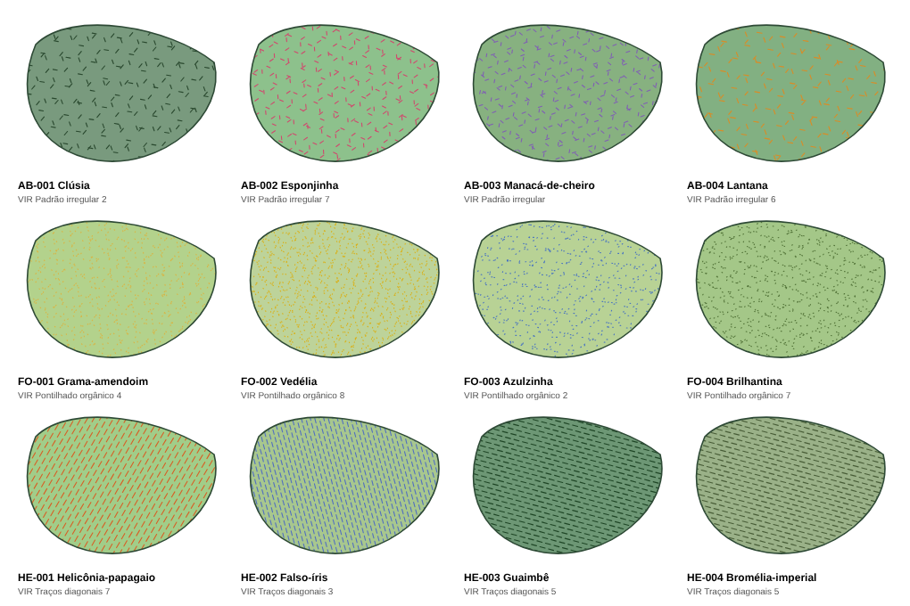

### Canteiros

| Ferramenta | O que faz |
|---|---|
| **Compor Canteiro** | Várias espécies **em uma única operação**. Escolha a região e clique no lado do **fundo** do canteiro (junto ao muro ou à divisa), ou ESC para um canteiro **em ilha** (alto no centro, frente em volta). Monte a receita: **destaques** por quantidade (árvores, palmeiras, esculturais), faixas de **fundo, meio e frente** em porcentagem da área e a **forração de base** (maciço em hachura sob todo o canteiro). O papel de cada espécie é sugerido pelo porte. A **prévia em planta** mostra o resultado ao vivo; *Sortear de novo* dá outra distribuição natural com as mesmas proporções. Os destaques ficam espalhados por igual e sob as copas também se planta (só a coroa junto ao tronco fica livre). Um único Desfazer volta tudo. |
| **Salvar Canteiro** | Grava um canteiro pronto (exemplares, maciços e contorno) como **modelo do escritório**, com nome e descrição. O modelo serve como **desenho** (Inserir Modelo) e também como **receita** em outro contorno (Compor Canteiro). |
| **Inserir Modelo** | Insere um canteiro salvo **igual ao original**, em qualquer projeto: escolha o modelo (com prévia), a rotação e clique onde fica o centro. Espécies que não estiverem no catálogo do computador são avisadas e ficam de fora. |

Os modelos ficam em `Dados\modelos-canteiro.json`, na pasta da biblioteca: com a biblioteca na rede, todo o escritório usa os mesmos. Receitas também podem ser gravadas pela própria janela de composição. As espécies são reencontradas pelo identificador ou pelo nome científico.

### Identificação

| Ferramenta | O que faz |
|---|---|
| **Etiquetar** | Seis modelos de etiqueta, uma por exemplar ou **uma por espécie** com a quantidade. As etiquetas **procuram uma posição livre** ao redor da planta, sem sobrepor outros textos, e ganham linha indicadora quando precisam se afastar. Também aceita os identificadores nativos de Vegetação do escritório. |
| **Codificar** | Códigos dos exemplares com formato configurável e renumeração dos códigos de espécie **por projeto**. |
| **Atualizar Etiquetas** | Refaz o texto das etiquetas a partir dos dados atuais. |
| **Legenda** | Vista de legenda com o símbolo colorido (ou a amostra da hachura na cor da espécie), **fotografia**, código, nomes e quantidade. |
| **Quadro de Fotos** | Coloca ao redor da planta a **fotografia de cada espécie**, com código e nome, ligada por linha a um exemplar, como nas pranchas de paisagismo ilustradas. As posições evitam linhas cruzadas; com região de corte ativa, o recorte é ampliado. Depois, cada foto pode ser **arrastada** livremente: o texto e a linha de ligação acompanham, e a linha também segue a planta se ela for movida. |


### Quantitativos

| Ferramenta | O que faz |
|---|---|
| **Relatórios** | Por espécie, por maciço, de **aquisição**, **orçamento** e **manutenção**, com exportação para Excel (`.xlsx` com todas as abas). |
| **Aquisição** | Lista de compra com reserva de reposição, unidade comercial e preço. |
| **Compras** (aba dos relatórios) | Registro do que **já foi comprado**, gravado no próprio projeto, comparado com o que o projeto pede hoje: o que **falta comprar** e o que **sobra** depois de substituições ou exclusões de espécies. Botões para marcar a lista como comprada ou completar só o que falta; aba própria na planilha do Excel. |
| **Orçamento** | Fornecimento e plantio a partir de uma **tabela de preços importada** pelo escritório (SINAPI, tabela municipal ou própria, em `.xlsx` ou `.csv`; o cabeçalho é localizado automaticamente). Vincula códigos de insumo e de serviço às espécies (busca na tabela), aplica o **BDI** e aponta unidades divergentes e códigos não encontrados. O Viridian não traz preços: os valores vêm sempre da tabela do usuário ou do cadastro. |
| **Manutenção** | Cronograma por espécie e mês: **rega de implantação** (pelo mês do plantio) e na estiagem (pela estação seca da região), **adubação** (inclusive de pré-floração), **podas logo após a floração**, poda de formação, limpeza de palmeiras, corte de gramados (quinzenal nas chuvas, mensal na seca), coroamento, tutoramento e **reposição de falhas** aos 30 e 90 dias com a reserva prevista. |

### Documentação

| Ferramenta | O que faz |
|---|---|
| **Prancha Automática** | Cria a prancha A1 com a planta ativa (opcionalmente com o quadro de fotos), a legenda com fotos e a tabela de quantitativos. A opção padrão é a **Folha Viridian A1** (2.4): moldura, coluna à direita com faixa do projeto, **notas gerais**, **rosa dos ventos girada pelo norte do projeto**, **escala gráfica**, quadro de **revisões** e **carimbo** (projeto, cliente, endereço, responsável técnico, escritório, número, data, escala e o número da prancha em destaque), tudo desenhado pelo plugin com os dados de Gerenciar > Informações do projeto; as vistas entram sem o título padrão do Revit e a planta ganha uma faixa de título própria. Também é possível usar um carimbo da família do escritório ou a folha sem carimbo. Reduz a escala para a planta caber e usa uma vista dependente quando a planta já está em outra prancha. |
| **Exportar CAD** | Exporta vistas e pranchas para **DWG** (2007 a 2018, em metros ou milímetros, com cores e preenchimentos da vista, opção de coordenadas compartilhadas) e gera a **biblioteca de blocos DXF** dos símbolos (espécies do projeto ou catálogo inteiro), com camadas por nível de detalhe, preenchimento e floração. |
| **Tabelas Nativas** | Cria as tabelas de vegetação do Revit (por espécie e por exemplar). |
| **Quadro de Especificação** | Tabela para a prancha com faixa de título e resumo, nota geral, **miniatura do símbolo** com a cor da flor, linhas alternadas, nome popular em negrito e científico em itálico, **linha de total por unidade** (mudas e m²) e código, espécie (nome popular e científico), quantidade, altura da muda, **escavação em centímetros** (cova ou camada) e a **especificação** de cada espécie, montada com os mesmos modelos das notas do detalhe de plantio. Com uma prancha aberta, o quadro é colocado nela. |

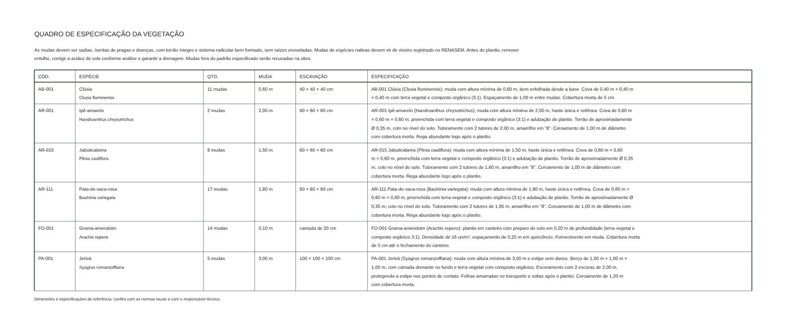

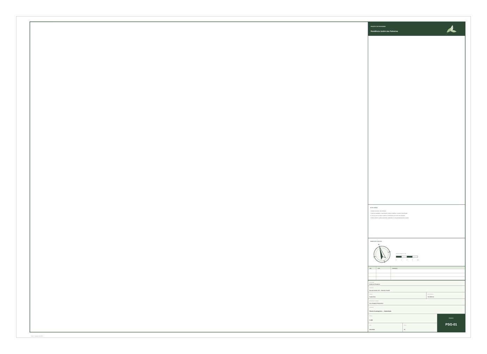

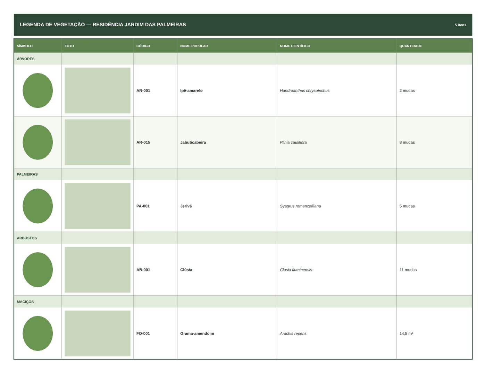

### Composição

| Ferramenta | O que faz |
|---|---|
| **Ateliê de Paletas** | Escolha de espécies pela cor: harmonias **monocromática, análoga, complementar e tríade** a partir de um matiz, ou **paletas prontas** (quente tropical, branco e verde, rosa e lilás, azul e roxo, entre outras). Filtra por categoria, somente nativas, somente com floração vistosa e **meses de floração** desejados. As espécies aparecem em ordem de afinidade com a cor da flor e da folhagem, com símbolo e foto; dali é possível inserir ou distribuir. Funciona mesmo sem projeto aberto. |
| **Verificar Canteiro** | Escolha a região: o canteiro é avaliado por **equilíbrio** (espécie dominante), **diversidade**, **contraste de texturas**, **escala** em relação às dimensões do canteiro, **sub-bosque** sob palmeiras e árvores, e **meses sem floração vistosa**. As observações são recomendações de composição, com clique duplo para ver as plantas; os limites ficam em Configurações > Composição. |
| **Estudo Solar** | Calcula as **horas de sol direto** numa região (malha de pontos) e na posição de cada planta, com a sombra das **copas adultas**, das **edificações e do terreno** (também de vínculos). **Local da obra:** latitude, longitude e fuso vêm da localização do projeto; se o projeto não tiver localização, o Viridian avisa e recomenda informar as coordenadas, que podem ser **coladas do Google Maps** (decimal ou graus/minutos/segundos) e **gravadas no projeto**; o giro do norte verdadeiro é considerado: a própria janela do estudo mostra o norte em uso e permite escolher para onde ele aponta na planta (cima, direita, baixo, esquerda ou um ângulo), com prévia, sugestão a partir do símbolo de norte da planta ou da prancha e gravação no projeto (2.5); o norte também pode ser **indicado clicando na planta** (Indicar Norte). **Período:** **mês a mês** (um dia típico de cada mês, recomendado) ou solstícios e equinócio. **Faixas de luz** editáveis: sol pleno forte (8 h ou mais), sol pleno (6 a 8 h), meia-sombra (3 a 6 h), sombra parcial (1 a 3 h) e sombra (menos de 1 h), com tolerância "no limite" de 1 h. **Resultado:** o **calendário de luz** (vista de desenho com nascer e pôr do sol em hora local, duração do dia e as horas de sol da região e de cada espécie em cada mês, marcando os meses em que a espécie não recebe a luz que pede), **mapas coloridos** em cópias da planta (média do ano e os meses escolhidos; a planta original não muda) e a lista das plantas fora da luz, com o critério em horas, mínimo e máximo do ano e os meses em que não atendem. Uma planta atende quando fica dentro da faixa na maioria dos meses; para as que não atendem, o Viridian **sugere** espécies do catálogo da mesma categoria e porte parecido (apenas sugestão; nada é trocado). **Sombras hora a hora:** para cada mês marcado, um **quadro de sombras** (vista de desenho) com uma pequena planta por hora cheia (hora legal, por exemplo das 7h às 17h): as sombras calculadas **pela geometria real do modelo** (2.5): edificações, muros, coberturas, pisos elevados e terreno (também de vínculos) projetados no plano do jardim pela posição do sol, cada copa como volume na sua altura que **filtra a luz pela espessura de folhagem atravessada** (centro escuro, borda em meia-luz, decíduas mais ralas nos meses sem folhas) e os **troncos**, tudo com **contornos suaves** em vez de quadradinhos; as edificações vistas de cima, o contorno de cada copa e o tronco, a direção de onde vem o sol e a porcentagem da região à sombra (chão, meia-luz, sombra e copas em tons suaves, sol com raios, seta do norte e barra de porcentagem); abaixo, a tabela de sol e sombra de cada espécie em cada horário, com faixas alternadas e barra de horas de sol. O calendário de luz e os mapas seguem a mesma paleta, com a faixa contínua de "menos sol" a "mais sol" na legenda. Opcionalmente, **cópias da planta com as sombras** nos horários escolhidos (por exemplo 9h, 12h e 15h) e a **exportação das imagens** (PNG) do calendário, dos mapas e dos quadros. O **porte** das plantas pode ser o adulto, aos 6 ou 3 anos ou o das mudas. Árvores de maciços também fazem sombra, e espécies **decíduas e semidecíduas** (campo **Folhagem** da ficha, estimado pelo gênero quando não cadastrado: ipês, paineiras, eritrinas, flamboyant...) fazem sombra mais rala nos meses sem folhas. |
| **Indicar Norte** | Para projetos desenhados fora do norte verdadeiro: clique em um ponto da planta e depois na direção do norte. Fica gravado no projeto e passa a valer no estudo solar, nos mapas e nas sombras; opcionalmente, gira também o norte verdadeiro do Revit (Gerenciar > Posição). Rodando de novo, é possível indicar outra vez ou apagar a indicação. |
| **Floração na Planta** | Painel de consulta (nada é desenhado): por **maciço** e por **espécie isolada** da vista ativa, os 12 meses pintados na cor da flor (cinza para floração discreta) e os **meses sem flor**, com uma linha de resumo da vista inteira. Escolha um mês para ver o que está florido e **isolar temporariamente na vista** só o que floresce nele, ou selecionar esses elementos (Redefinir ocultar/isolar temporário volta ao normal). |
| **Calendário de Floração** (botão *Criar calendário na prancha* dentro de Floração na Planta) | Quadro de **janeiro a dezembro** com o que floresce no projeto, cada mês pintado na cor da flor, a quantidade de cada espécie e os **meses sem floração** destacados. É criado como vista de desenho, pronta para a prancha. |

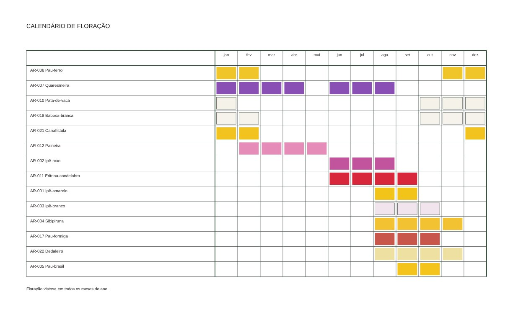

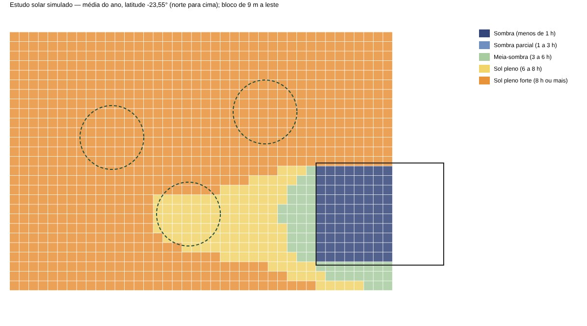

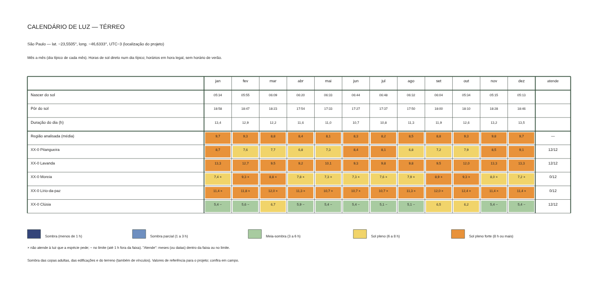

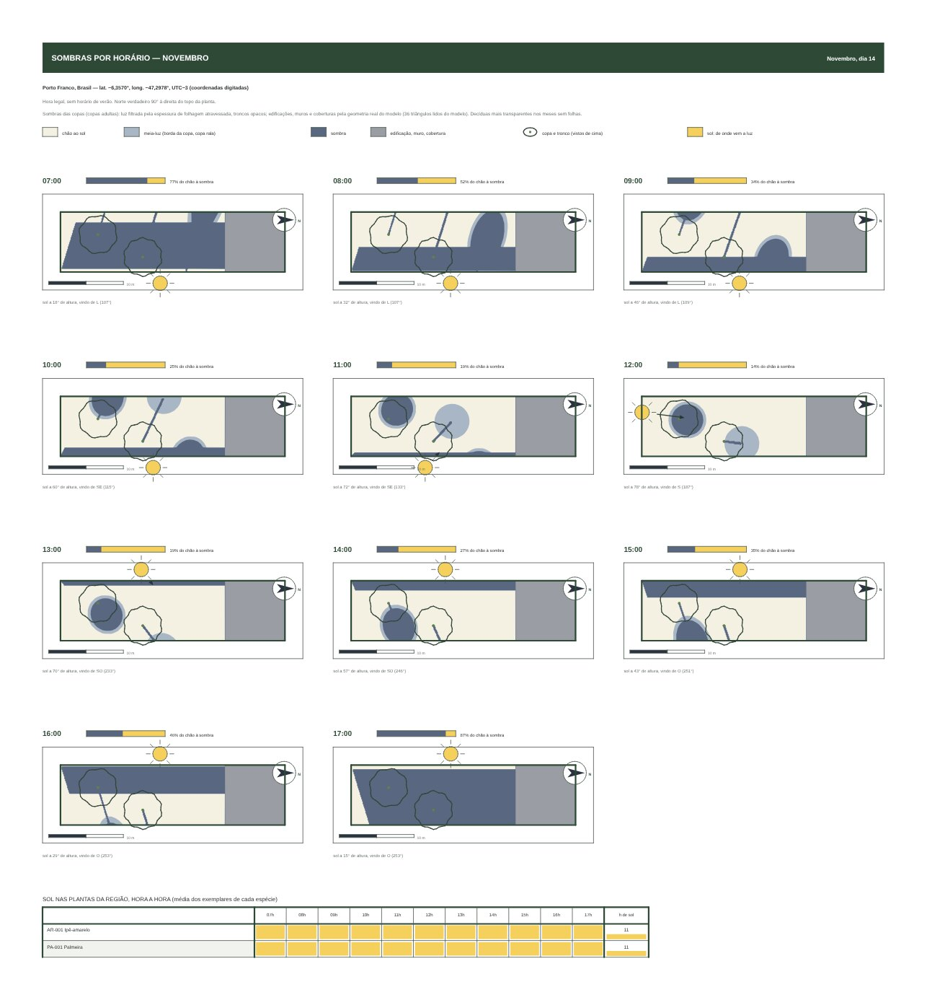

### Pisos e Drenagem

| Ferramenta | O que faz |
|---|---|
| **Gerador de Pisos** | Biblioteca com mais de 30 pisos de paisagismo: **cimentícios e atérmicos, fulget (granito lavado) moldado e em placas, intertravados (espinha de peixe, amarrado, trama, hexagonal, veicular), drenantes (blocos, placas e concreto permeável), pedras naturais (São Tomé serrada e em cacos, Miracema, ardósia, basalto, granito flameado, Goiás em opus), pedra portuguesa, porcelanatos externos (inclusive de 2 cm sobre grama), tijolo, concreto desempenado e veicular, decks de madeira e WPC, pedrisco, seixo, emborrachados e grama-concreto**. Tudo é personalizável: dimensões da peça, junta, rotação, **paginação** (junta reta, amarração 1/2 e 1/3, espinha de peixe 90° e 45°, trama, diagonal, hexagonal, opus, cacos, mosaico, réguas, granular e vazado), cores, caimento, perda e **camadas** (assentamento, argamassa, contrapiso, base, sub-base, manta, barrotes). A prévia mostra o piso em escala real. Daí: **aplicar aos pisos selecionados** do Revit, **criar o tipo de piso** (camadas e material com a paginação na superfície, em escala real), criar a **hachura para plantas** (região preenchida), o **detalhe em corte** com hachuras de material, cotas, chamadas e uma **amostra da paginação em planta** acima do corte, e o **quantitativo** (área, perda, peças e volume de cada camada, com exportação para Excel). A biblioteca fica na pasta da biblioteca do escritório; os pisos padrão trazem as referências das medidas. |
| **Pedras e Coberturas** | Catálogo próprio com **31 materiais soltos**: seixos (branco, natural de rio, preto, bege, pequeno e grande), dolomita, mármore e quartzo triturados, pedriscos (branco, granito, natural, basalto, vermelho), britas (branca, cinza, colorida, brita 2 e 3), pedra de mão, cascalhos fino e grosso, pó de pedra, saibro, bica corrida, areia grossa, argila expandida, cascas de pinus e cavaco de madeira. Cada material ganha uma **textura própria** (2.1), gerada a partir dos seus dados — seixos rolados e arredondados, britas e pedriscos angulosos com faces, pedra de mão em blocos, pó de pedra, areia e saibro em grão fino, argila expandida em bolinhas, cascas e cavacos em lascas —, no tamanho da granulometria e nas cores do material, com luz e sombra entre as pedras; ela vai para a **aparência do material no Revit, na escala real** (estilo Realista e renderização) e aparece como amostra na janela. Cada material tem **tipo, origem, rocha, granulometria, cor, cor dos grãos, usos**, camada usual, **densidade, vazios, perda e compactação, saco de venda** (kg ou litros) e código de preço; tudo editável, e você cria os seus. Os **usos** definem as camadas e as observações de execução: **cobertura de canteiro** e **borda de caminho** (sobre manta), **piso solto** (manta e base compactada, com contenção), **piso compactado** (base compactada e caimento), **camada drenante** e **cobertura morta**. O desenho dos grãos segue o material: **seixos arredondados, britas angulosas, lascas** para as cascas e pontilhado para os finos, na cor do material. No Revit: **cobrir uma região** (canteiro, piso, região, área, ambiente ou contorno desenhado), **borda de caminho** com largura e lado (contornando um piso ou região, ou ao longo de linhas, arcos e paredes, ou desenhada), **aplicar** a pisos selecionados, criar o tipo de piso, a hachura para plantas e o detalhe em corte. Tudo vira piso do Revit e entra no **quantitativo** do Gerador de Pisos com **volume, peso e sacos**. A calculadora da janela mostra quanto comprar para qualquer área. Densidades e vazios são valores de referência: confirme com o fornecedor. |
| **Jardim de Chuva** | Dimensiona o jardim pelo volume a reter (**área de contribuição × coeficiente de escoamento × chuva de projeto**) e pelo armazenamento da lâmina e das camadas porosas; confere a área escolhida na planta, estima o tempo de esvaziamento pela infiltração do solo e indica quando prever **dreno de fundo**. Sugere espécies do catálogo para o **fundo** (tolerantes a alagamento), os **taludes** e as **bordas**, nativas primeiro e sem invasoras, e cria o **detalhe em corte** ilustrado (água, cobertura, substrato, brita com hachuras, manta, extravasor, dreno, setas de escoamento e infiltração, plantas do fundo, talude e borda) com o quadro de **memória de cálculo**. Selecionar telhados e pisos antes do comando soma a área de contribuição. A **camada drenante** e a **cobertura morta** podem ser escolhidas no catálogo de pedras e coberturas: a porosidade vem dos vazios de referência do material e os nomes aparecem no detalhe e no memorial. Os valores são de partida e editáveis: confirme com o manual de drenagem do município e com o ensaio de infiltração. |

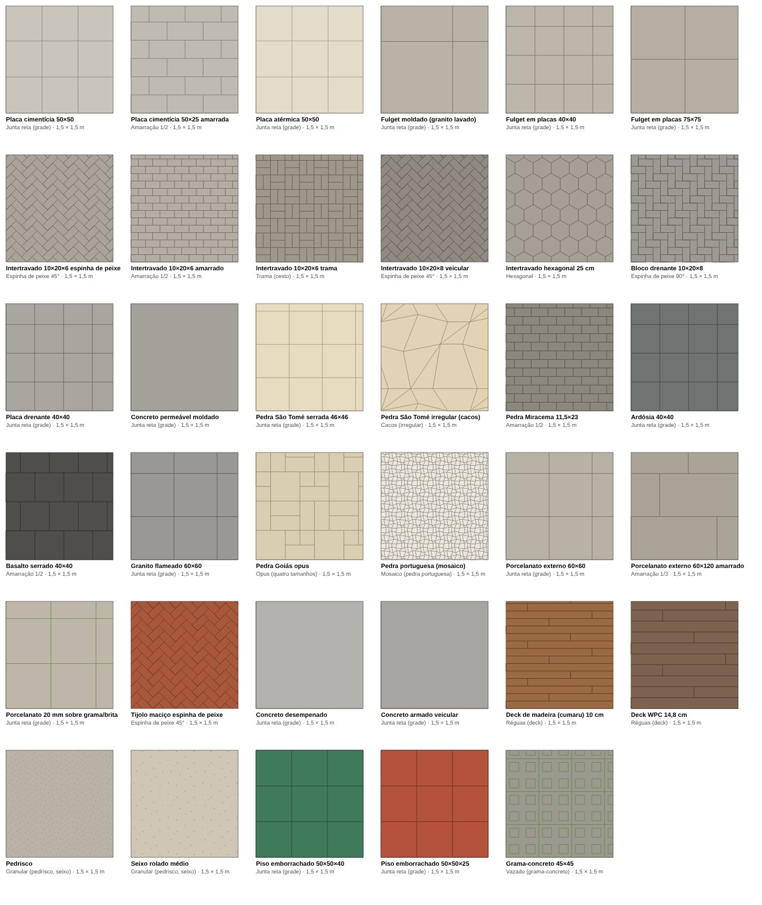

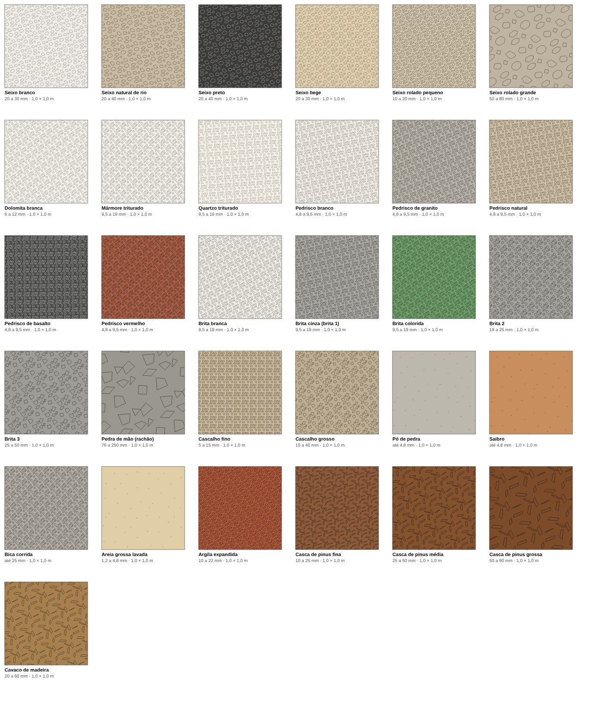

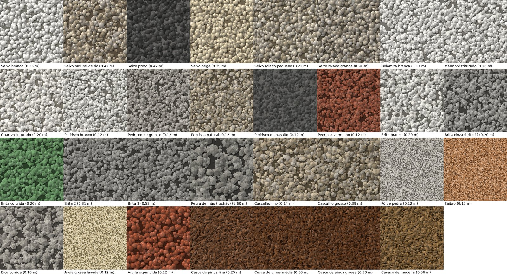

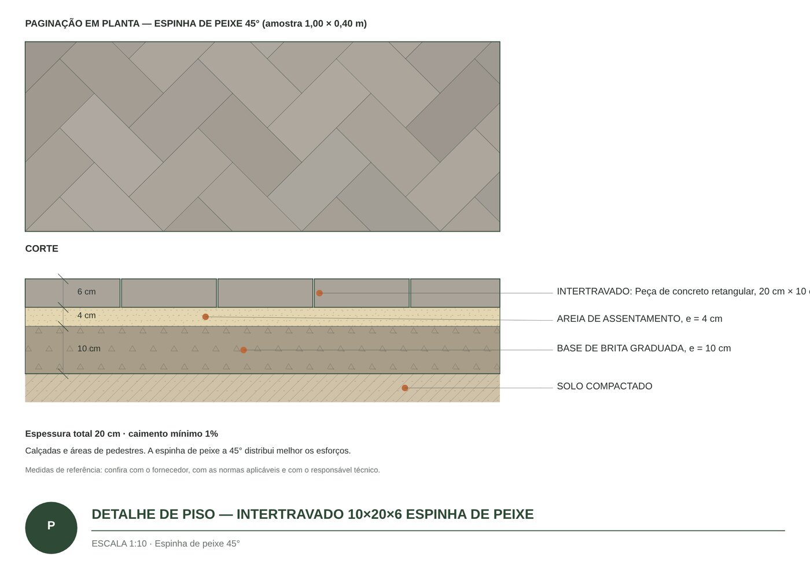

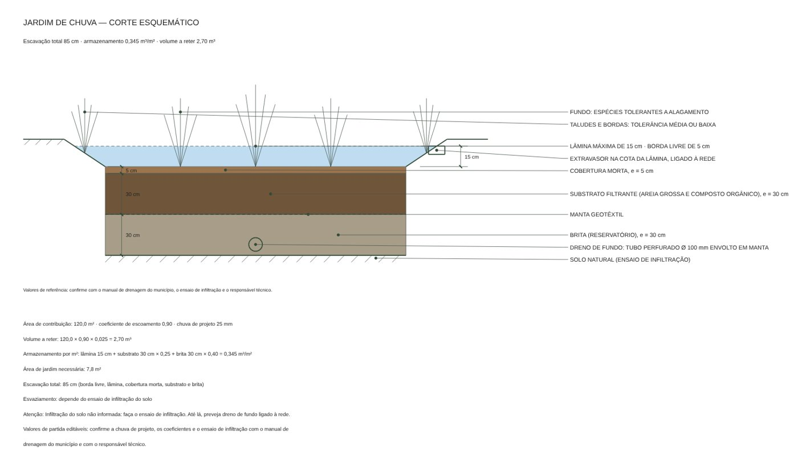

### Detalhamento

| Ferramenta | O que faz |
|---|---|
| **Memorial Ilustrado** | Memorial descritivo em **Word editável** (`.docx`): capa com faixa de título, mosaico de fotos e quadro de dados do projeto, sumário, rodapé com o nome do projeto e número da página, tabelas com cabeçalho verde e linhas alternadas, partido paisagístico (texto-base para completar), paleta vegetal, **ficha de cada espécie com foto**, calendário de floração, especificações de plantio, manutenção e créditos das fotografias. Os dados do projeto vêm de Gerenciar > Informações do projeto. |
| **Detalhe de Plantio** | Detalhes em corte, ilustrados com **hachuras de material** (terra vegetal, solo natural, brita, areia, torrão, cobertura morta, madeira) e a planta desenhada com copa, tronco e flores, de **cova de árvore** (com tutor e amarrio), **berço de palmeira**, **cova de arbusto**, **canteiro de forração** e **gramado**, com cotas, chamadas e as **notas de especificação** de cada espécie em quadros sob a faixa de título (número, título e escala). As dimensões da cova seguem a altura da muda. |
| **Corte Esquemático** | Desenhe uma linha na planta: as plantas cortadas (e próximas à linha) aparecem em **silhueta** com altura e copa reais, conforme o tipo (árvore pela forma da copa, palmeira, arbusto, forração), com régua de alturas e linhas-guia, figura humana de 1,70 m para escala, plantas atrás da linha em tom mais claro e códigos em duas fileiras quando ficam próximos. Pode mostrar a vegetação **no plantio, aos 3 ou 6 anos ou na maturidade**. |
| **Crescimento 2D** | O mesmo canteiro em quatro quadros, **no plantio, aos 3 anos, aos 6 anos e na maturidade**, com as copas estimadas pela taxa de crescimento de cada espécie: mostra quando o canteiro fecha e onde haverá sobreposição. Cada quadro traz a altura média e a **porcentagem do canteiro coberta pelas copas**. |

As notas de especificação são montadas a partir de **modelos editáveis** (Configurações > Composição): um modelo geral e um por tipo de plantio (árvore, palmeira, arbusto, forração, gramado), com campos como `{nome_popular}`, `{altura_muda}`, `{cova_largura}`, `{cova_profundidade}`, `{camada_solo}`, `{tutor}` e `{espacamento}`.

Os valores de cova, camada de solo, tutoramento e crescimento são **referências de projeto** e devem ser conferidos pelo responsável técnico.

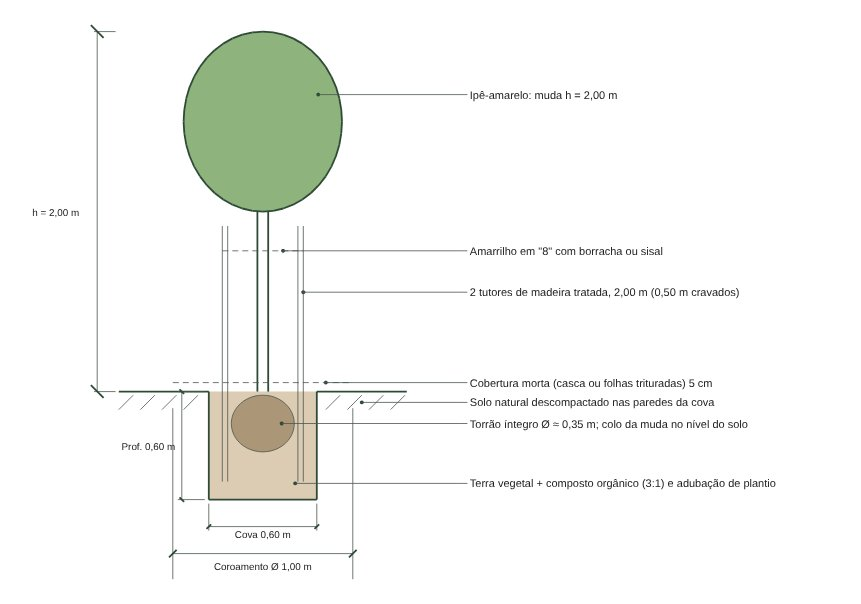

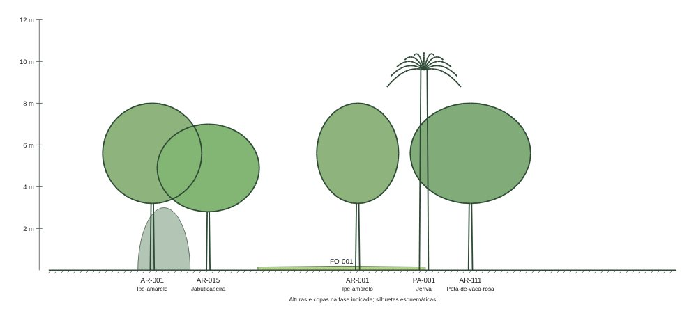

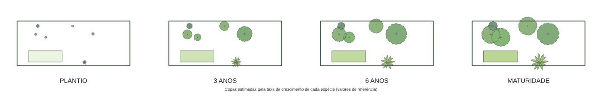


### Maquete 3D

| Ferramenta | O que faz |
|---|---|
| **Maquete 3D** | Cria a vista "Viridian - Maquete 3D" com a vegetação **em volume**. A janela da maquete escolhe o recorte (**projeto inteiro** ou **uma região** da planta), o **motor** (botânico ou o gerador simples das versões anteriores), a **qualidade** (Simplificada, Intermediária ou Detalhada), a **época do ano** (folhagem, flores e frutos do mês escolhido), a **fase de crescimento** (plantio, 3 anos, 6 anos ou maturidade) e se mostra flores, frutos e arestas. Uma estimativa de peso (triângulos) é atualizada a cada escolha. As plantas são **assentadas sobre o terreno** (toposólido ou superfície topográfica, também em vínculos); em lajes, coberturas e pisos, ficam sobre eles. |
| **Atualizar Maquete** | Refaz a maquete com o mesmo recorte e as mesmas escolhas, depois de mudanças no plantio. Maquetes criadas em versões anteriores continuam no gerador simples (a aparência só muda se você gerar de novo pela janela). |
| **Remover Maquete** | Apaga a maquete, os materiais criados para ela e a vista (quando não está em uma prancha). |
| **Diagnóstico 3D** (menu Configurar) | Opcional: confere no seu Revit uma família com símbolo 2D e árvore 3D (inserida, conferida vista a vista e por nível de detalhe, 25 exemplares e recarga) e as texturas do ipê na vista realista, e guarda um relatório para consulta. Não é preciso enviar nada. Por padrão o projeto volta a ficar como estava. |

**Motor botânico (1.9).** Cada espécie recebe um **perfil 3D** pela arquitetura da planta: árvores de copa arredondada, espalhada, colunar, cônica ou irregular (copa formada por grupos de folhagem sobre galhos primários e secundários, cônicas em andares), palmeiras de estipe único, em leque ou em touceira (folhas pinadas com folíolos ou leques plissados, palmito, cachos de frutos), arbustos, trepadeiras conduzidas, forrações, gramíneas e touceiras de folhas em fita, rosetas (agave, bromélias, inclusive as de tanque com o centro colorido na floração), herbáceas de folhas largas (helicônias, filodendros, estrelítzia com a flor ave-do-paraíso, árvore-do-viajante) e aquáticas. Há perfis de referência para ipê, flamboyant, araucária, jerivá, palmeira-imperial, agave e estrelítzia. O perfil é escolhido automaticamente pelo gênero, pela categoria e pela forma da copa, ou na ficha da espécie (campo **Perfil 3D**); os perfis ficam em `Dados\perfis-3d.json`.

- **Qualidade:** cada nível tem um **orçamento de triângulos** por tipo de planta (por exemplo, árvore 350 / 1.500 / 4.000); quando a planta passa do orçamento, o detalhe é reduzido e o resumo informa quantas foram ajustadas. Antes de gerar, uma maquete pesada pede confirmação e sugere o nível que cabe.
- **Estação:** com o mês de referência, decíduas ficam **sem folhas** e semidecíduas com **folhagem rala** nos meses da ficha; **flores** aparecem só na época de floração e **frutos** só na de frutificação. A época vem da ficha (campos Floração, Frutificação e Cor do fruto) ou é **estimada pelo gênero** quando a ficha não informa — o resumo diz quantas foram estimadas, e a ficha mostra a origem. Floração vistosa cobre a copa: o ipê sem folhas fica amarelo, o flamboyant ganha manchas vermelhas. No hemisfério norte (pela localização do projeto), os meses se deslocam seis meses.
- **Variação natural:** exemplares da mesma espécie diferem um pouco (sempre para menos que o porte previsto); desligada, todos ficam iguais. A geometria é reprodutível: o mesmo exemplar gera sempre a mesma forma.
- **Folhas** de palmeiras, rosetas e placas de folha do nível Detalhado são superfícies de face única (o Revit mostra os dois lados); troncos, galhos, grupos de folhagem, flores e frutos são sólidos. Cada parte tem material próprio: folhagem em três tons (luz, base e sombra), tronco, galho, flor e fruto.
- A vista abre em **sombreado sem arestas** (as copas ficam mais naturais); as arestas podem ser ligadas na janela.

A maquete é **opcional e não altera o que já existe**: as formas são geradas sem família (formas diretas, categoria Entorno), com representação vazia em planta, de modo que **as plantas baixas continuam mostrando só os símbolos 2D**, e não entram nos quantitativos nem nas tabelas. Elas aparecem nas vistas 3D, nos cortes e nas elevações; em projetos com subprojetos, ficam no subprojeto "VIR Maquete 3D", oculto por padrão nas outras vistas. A maquete não acompanha as mudanças sozinha: depois de alterar o plantio, use **Atualizar Maquete**. Se o Revit recusar a geometria da maioria dos exemplares, a geração é interrompida e a maquete anterior é mantida.

**Vegetação ilustrada como RPC (2.0 a 2.2).** Todas as espécies do catálogo (e as criadas pelo escritório) aparecem nas vistas 3D, cortes e elevações como uma **imagem ilustrada que fica sempre de frente para a câmera**, como um RPC: não importa como a vista seja girada, você vê a planta inteira, nunca as faces. O estilo é o dos símbolos, com copa em massas de folhas serrilhadas e volume em três tons, contorno com peso variado, flores em cachos, nervuras nas folhas grandes, tronco com realce, coníferas em cone, palmeiras com a coroa recortada, forrações com contorno suave e gramados em tufos de grama. Só as espécies com família de plantio própria do escritório ficam de fora.

**Nível de detalhe (2.2).** Cada espécie é desenhada a partir dos seus próprios dados: altura e copa da ficha (o desenho é ajustado às medidas quando o modelo gerado sai menor ou maior; flores sobem inteiras, sem deformar, e nas aquáticas ganham haste até a altura da ficha; agaves e rosetas rígidas são desenhadas folha por folha), formato da folha pelo perfil 3D (folíolos em leque nos ipês, folíolos pinados na sibipiruna e no flamboyant, agulhas nas coníferas, lâminas nas dracenas, folhas cordiformes e suculentas), tamanho da folha pela textura (fina, média, grossa) e casca pelo tipo (sulcos na maioria das árvores, lisa com manchas em pau-ferro, goiabeira e jabuticabeira, acúleos na paineira e na eritrina, anéis no estipe das palmeiras e nos caules de dracenas). A copa tem luz em quatro camadas, mais escura embaixo e no miolo, profundidade (o fundo fica mais claro e menos saturado), folhas novas amareladas no alto, luz de contorno na borda iluminada, traço mais grosso no lado da sombra e flores em cachos nas pontas, mais ralas nas fases jovens. As palmeiras em leque têm as pregas das folhas. Nos maciços, cerca de um quarto das plantas aparece ainda jovem, para o canteiro não ficar uniforme.

- **Como funciona:** o Viridian desenha as imagens na própria vista pelo serviço DirectContext3D do Revit (não cria elementos nem altera o modelo). Para cada fase há 16 imagens em volta da planta (de 22,5° em 22,5°) e uma vista de cima, usada quando a câmera olha do alto. As imagens são geradas a partir do modelo botânico de cada espécie, na primeira vez em que são vistas, e ficam guardadas durante a sessão.
- **Maciços:** os maciços em hachura e os de área (forrações, gramados) aparecem nas vistas 3D como um **tapete** na cor da espécie, com textura de folhas (ou de folhas de grama nos gramados), e **plantas ilustradas** nos pontos de plantio — até 200 por maciço (70 nas plantas baixas, onde o tapete já dá a cor), espaçadas por igual nos maciços grandes. Os maciços em modo símbolos aparecem pelos próprios exemplares. O tapete fica 1 cm acima do nível da vista do maciço.
- **Estilos visuais:** as cores vêm do próprio desenho, então ficam iguais em **Sombreado, Cores consistentes e Realista**. Em **Linha oculta** a planta fica em preto e branco; em **Estrutura de arame**, só o contorno.
- **Planta baixa:** só o símbolo 2D, como sempre. As cores da planta baixa (copa e floração) são escondidas automaticamente nas vistas 3D, para não aparecerem como um disco no chão.
- **É o mesmo elemento da planta:** mesma etiqueta, mesmo código, mesma linha nas tabelas. Para selecionar o exemplar numa vista 3D, clique no tronco (a família tem um eixo de seleção fino, oculto em planta).
- **Fase por exemplar:** o parâmetro **"VIR Fase 3D"** escolhe a fase — 1 Plantio, 2 Aos 3 anos, 3 Aos 6 anos, 4 Adulta (padrão) e, nas decíduas, 5 Adulta sem folhas. É parâmetro (e não tipo) para as tabelas continuarem com uma linha por espécie. **"VIR 3D visível"** esconde a imagem de um exemplar; a subcategoria **"VIR Volume 3D"** em Visibilidade/Gráficos esconde todas na vista. As imagens respeitam a caixa de corte da vista 3D e o recorte de cortes e elevações.
- **Projetos existentes:** rode **Atualizar Dados** uma vez para preparar as famílias (Verificar Projeto as aponta como "símbolo ou vegetação ilustrada" desatualizados). Plantas inseridas depois já entram prontas.
- A **Maquete 3D não duplica** as plantas nem os maciços ilustrados. Onde o terreno está mais de 15 cm acima ou abaixo do exemplar, a maquete esconde a imagem e põe a planta em volume sobre o terreno.
- Em **Configurações**, a opção "Vegetação ilustrada em 3D (RPC)" liga e desliga o recurso.
- **Pranchas, impressão, PDF e Realista:** o desenho ao vivo aparece nas vistas abertas e nas janelas de vista das pranchas abertas, em todos os estilos (inclusive Realista). Para a vegetação sair na **impressão, no PDF, nas imagens exportadas e na renderização**, use **Maquete 3D > Vegetação nas Pranchas**: o desenho de cada vista 3D das pranchas (ou da vista ativa) vira formas reais de frente para a câmera da vista, uma por cor, com materiais de cor e aparência próprias (também no Realista) e arestas na mesma cor da forma (sem o traço preto de cada triângulo). As formas de uma vista ficam ocultas nas outras vistas e nas plantas (filtros "VIR Vegetação fixa"), e os eixos de seleção e as cores da planta baixa são escondidos nessas vistas. Depois de mudar o plantio ou girar a vista, rode de novo; a mesma janela desfaz a fixação.
- **Não é um arquivo .rpc da ArchVision** (formato proprietário que só a ferramenta deles cria): é o mesmo comportamento, feito pelo Viridian. Por isso as imagens aparecem só com o Viridian carregado; sem ele, as plantas ficam só com o símbolo 2D e o eixo.

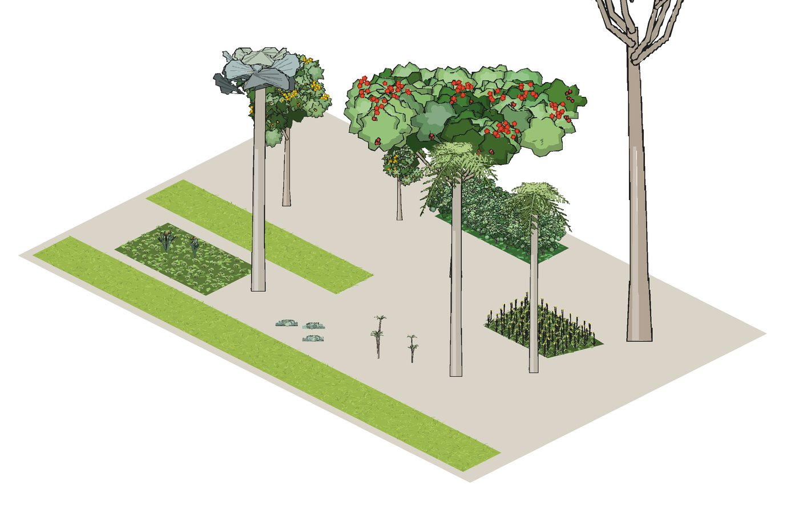

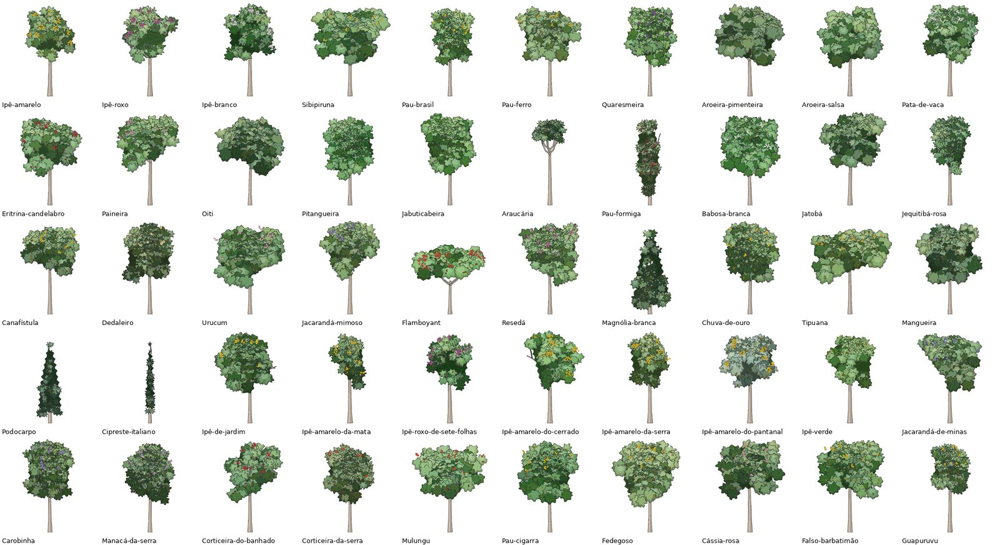

**Limites conhecidos.** As formas diretas do Revit não guardam coordenadas de textura (UV): a maquete usa cores por parte, e texturas só fazem sentido na vista Realista. Na vegetação ilustrada, ao girar a vista a imagem troca de 22,5° em 22,5°, como num RPC. As imagens são desenho, não foto: não fazem sombra nem reagem à luz do sol. A impressão e a exportação em PDF de vistas 3D com a vegetação ilustrada dependem do Revit tratar o desenho direto da vista (em geral, só na impressão como imagem); se uma folha precisar sair impressa com as plantas em volume, use a Maquete 3D nela. As épocas estimadas pelo gênero são referências gerais e devem ser conferidas para a região da obra.

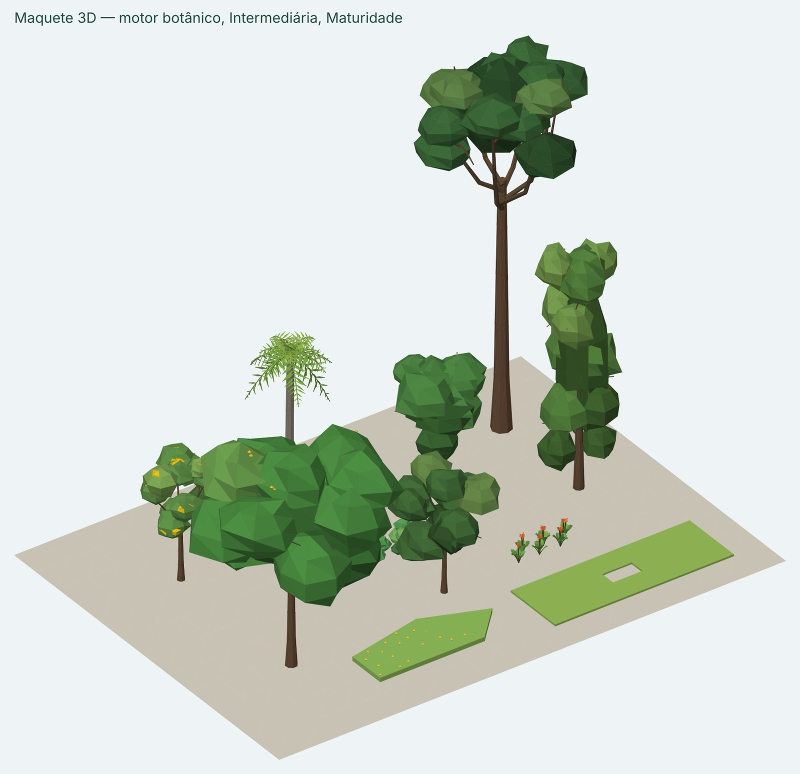

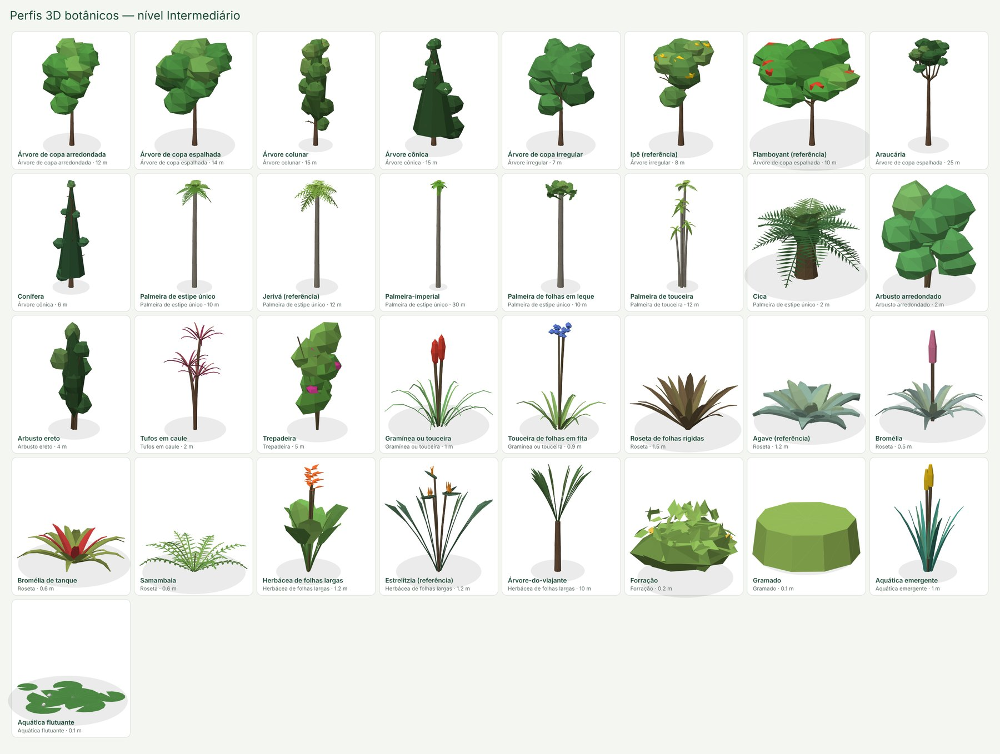

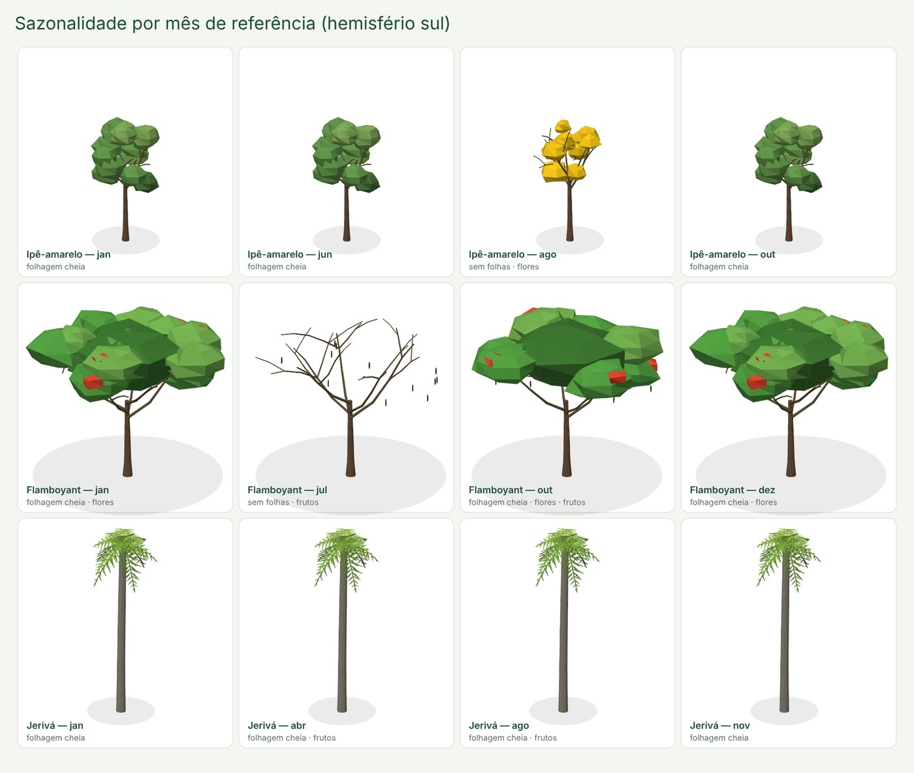

### Verificação

| Ferramenta | O que faz |
|---|---|
| **Verificar Projeto** | Exemplares sem código, códigos duplicados, famílias não cadastradas, tipos desatualizados, maciços sem densidade, limites inválidos, exemplares fora do canteiro, duplicados, órfãos, **conflitos de copa**, **espaçamento insuficiente** e **interferências**. Clique duplo mostra os elementos; há correção automática para códigos, dados e registros órfãos. |
| **Interferências** | Distância do tronco a **tubulações, eletrodutos, dutos, eletrocalhas, postes e luminárias, equipamentos elétricos e paredes**, por tipo de planta (árvore, palmeira, arbusto), considerando o diâmetro das redes e a copa adulta junto às fachadas; aponta também plantas **sobre pisos sem berço**. Lê o projeto e os **modelos vinculados** (instalações, arquitetura, infraestrutura). As distâncias são editáveis. |

### Configurações

| Ferramenta | O que faz |
|---|---|
| **Escalas** | Perfis de representação **Detalhado**, **Intermediário**, **Simplificado** e **Mínimo**. A dimensão real do símbolo nunca muda; só o detalhamento. |
| **Configurações** | Biblioteca, escalas, padrão gráfico das linhas, **cores** (preenchimento sólido ou reticulado, clareamento, floração, maciços coloridos e cor-base de cada categoria, com pré-visualização), **interferências**, **composição** (limites das regras, modelos das notas de especificação, maquete 3D, estudo solar e **módulos** que podem ser desligados), **acessibilidade**, maciços, plantio, codificação, análise, etiquetas e hachuras do escritório. |
| **Sobre** | Versão e atalhos para as pastas da biblioteca, de configurações e de registros. |

---

## Representação gráfica

Os símbolos 2D são gerados proceduralmente, em **dimensão real**, centrados no ponto de inserção e organizados em camadas (subcategorias da Vegetação), ligadas e desligadas conforme a escala da vista:

| Camada | Visível em |
|---|---|
| VIR Contorno mínimo | Mínimo |
| VIR Centro | todos |
| VIR Contorno | Detalhado, Intermediário, Simplificado |
| VIR Estrutura essencial | Detalhado, Intermediário, Simplificado |
| VIR Ramificação principal | Detalhado, Intermediário |
| VIR Detalhe | Detalhado |
| VIR Preenchimento (copa colorida) | Detalhado, Intermediário, Simplificado |
| VIR Floração (manchas de flor) | Detalhado, Intermediário |

### Cores

Cada espécie recebe a cor da sua folhagem (ou uma variação suave e estável da cor-base da categoria) e, quando floresce de forma vistosa, manchas na cor da flor. As linhas usam tons de verde-escuro e marrom, que leem bem sobre as copas e também em impressão em preto e branco. O preenchimento pode ser **sólido**, **reticulado** ou desligado.

No Revit, as cores ficam em **superfícies finíssimas (2 mm) com material na cor** da copa e da flor, dentro da própria família de vegetação: o padrão de superfície do material mostra a cor em planta nos estilos "Linhas ocultas" e "Sombreado", e as linhas do símbolo ficam por cima. Não depende de nenhum outro modelo de família. Essas camadas ficam nas subcategorias VIR Preenchimento e VIR Floração (as escalas as ligam e desligam), não aparecem em elevações e cortes e ficam ocultas na Maquete 3D; em outras vistas 3D aparecem como discos coloridos no chão, que podem ser ocultados em Visibilidade/Gráficos. Se o Revit recusar, o Viridian tenta outros dois métodos e, se nenhum servir, avisa mostrando o motivo. Em projetos criados com versões anteriores, rode **Atualizar Dados** para regerar os símbolos coloridos.

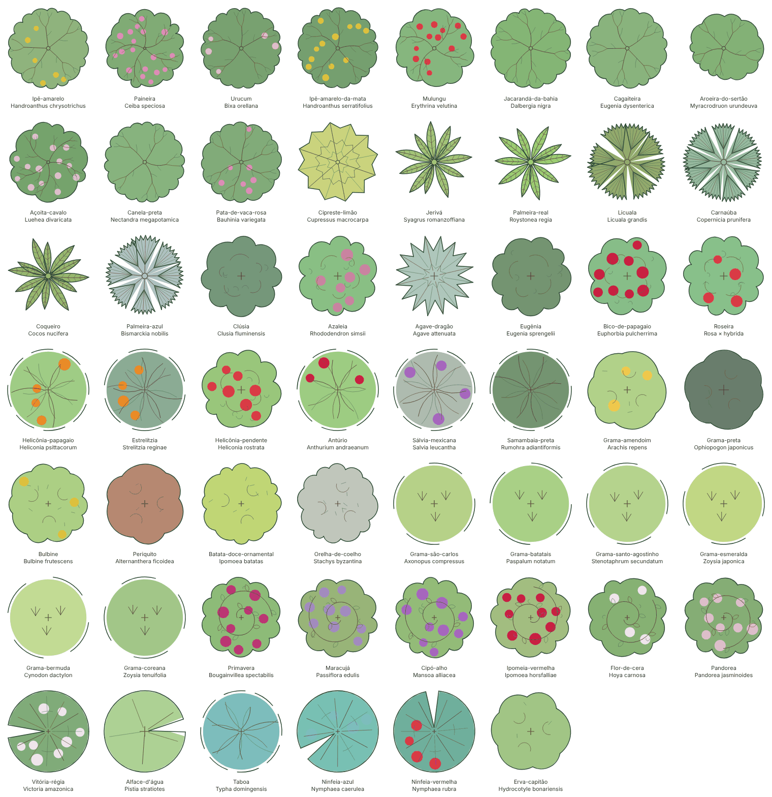


São 17 estilos de símbolo, cada espécie com semente própria (o desenho é sempre o mesmo para a mesma espécie) e até quatro variantes.


---

## Acessibilidade

- Interface inteiramente em português, com números na notação brasileira.
- **Tamanho do texto e dos controles** de 100% a 150% (Configurações > Acessibilidade).
- **Alto contraste** próprio, e o alto contraste do Windows é seguido automaticamente.
- Cores do tema verificadas por teste automatizado contra o contraste mínimo da **WCAG 2.1 (AA)**.
- Navegação por teclado: Tab entre os campos, Alt + letra sublinhada, Enter confirma e Esc cancela; campos com nomes para leitores de tela.

---

## Parâmetros BIM

Todos os parâmetros são **compartilhados** (prefixo `VIR_`), vinculados à categoria Vegetação e utilizáveis em tabelas e identificadores nativos.

- **Tipo:** `VIR_CodigoEspecie`, `VIR_NomePopular`, `VIR_NomeCientifico`, `VIR_Categoria`, `VIR_FamiliaBotanica`, `VIR_Origem`, `VIR_AlturaAdulta`, `VIR_CopaAdulta`, `VIR_EspacamentoRecomendado`, `VIR_UnidadeFornecimento`.
- **Instância:** `VIR_CodigoProjeto`, `VIR_Status`, `VIR_VarianteGrafica`, `VIR_EstagioImplantacao`, `VIR_Observacoes`, `VIR_IDMacico`.

Opcionalmente, o código da espécie é gravado também em **Marca de tipo** e o do exemplar em **Marca**.

---

## Onde ficam os arquivos

| Pasta | Conteúdo |
|---|---|
| `%APPDATA%\Viridian\Biblioteca` (configurável) | `Dados\catalogo.json`, `Dados\modelos-canteiro.json` (modelos de canteiro), `Dados\tabela-precos.json` (tabela importada), `Dados\pisos.json` (biblioteca de pisos), `Dados\pedras.json` (pedras e coberturas), `Dados\perfis-3d.json` (perfis 3D da maquete), `Texturas\Pedras` (texturas geradas das pedras), famílias geradas por categoria, `Personalizado\` (famílias, símbolos, hachuras, etiquetas) e `Fotos\` (fotos próprias do escritório) |
| `%APPDATA%\Autodesk\Revit\Addins\2027\Viridian\Fotos` | fotografias do catálogo padrão e `CREDITOS.txt` |
| `%APPDATA%\Viridian\Config` | `viridian.config.json` e o arquivo de parâmetros compartilhados |
| `%APPDATA%\Viridian\Logs` | registro de erros |
| `%APPDATA%\Viridian\Testes do motor 3D` | relatórios, famílias, texturas e imagens do Diagnóstico 3D (uma pasta por execução) |

Os arquivos são gravados de forma atômica. Um catálogo corrompido é copiado para backup e recriado a partir do padrão. Ao atualizar o plugin, as espécies do catálogo padrão que o escritório não editou são atualizadas, e as editadas recebem apenas os dados novos (biomas, cores, foto, tolerância à seca e ao encharcamento), preservando o que foi alterado.

---

## Compilar a partir do código

Requisitos: **SDK do .NET 10** (10.0.100 ou superior). O Revit não é necessário para compilar: a API é referenciada pelos pacotes `Nice3point.Revit.Api` 2027, que não são copiados para a saída.

```bash
dotnet test tests/Viridian.Tests -c Release
```

```bash
build/package.sh
```

No Windows, use `build\package.ps1`. O pacote é gerado em `dist/`.

### Estrutura

| Projeto | Responsabilidade |
|---|---|
| `Viridian.Core` | Regras sem dependência do Revit: geometria, símbolos e cores, distribuição e eixos de plantio, maciços, escalas, codificação, hachuras, relatórios, orçamento e leitura de tabelas de preços, cronograma de manutenção, interferências, diagramação de pranchas, verificação, composição (paletas, texturas, calendário de floração, regras de canteiro), detalhamento (detalhes de plantio, cortes, crescimento, especificações, quadro de especificação, escavação), pisos (paginações, hachuras de modelo, camadas, detalhe e quantitativo), jardim de chuva, estudo solar (posição do sol e sombras), comparativo de compras, maquete 3D (perfis botânicos, geradores procedurais por arquitetura com orçamento de triângulos, sazonalidade, validação e hash das malhas, texturas procedurais e gravação de PNG, triangulação dos maciços), vegetação ilustrada (16 imagens por fase e vista de cima, rasterização em regiões de cor, triangulação e regra de posicionamento de frente para a câmera), memorial e exportação `.xlsx`, `.docx` e `.dxf` |
| `Viridian.Library` | Catálogo botânico, catálogo padrão (dados e créditos das fotos), biblioteca de pisos, tabela de preços, configurações, pastas e registro de erros |
| `Viridian.Revit` | Integração com a API: parâmetros compartilhados, Extensible Storage, famílias com copa colorida, plantio, eixos, maciços, perfis de escala, etiquetas, legenda, tabelas, pranchas, exportação DWG, leitura de redes nos vínculos, desenho das vistas de detalhamento, maquete 3D (formas diretas, materiais por parte, terreno), vegetação ilustrada desenhada como RPC pelo serviço DirectContext3D (imagem sempre de frente para a câmera, fase por parâmetro) e diagnóstico 3D, tipos de piso em camadas, estudo solar (obstrução e mapa) e gravação das compras no projeto |
| `Viridian.UI` | Janelas WPF |
| `Viridian.Addin` | `IExternalApplication`, faixa de opções, comandos e atualização automática de escala |
| `tests/Viridian.Tests` | Testes automatizados (xUnit) |
| `tools/Viridian.Preview` | Gera pranchas SVG dos símbolos, cores, distribuições, hachuras, detalhamentos, pisos, jardim de chuva, estudo solar e da maquete 3D (cena, perfis 3D, níveis de qualidade, estações, espécies de referência e texturas do teste T0), e um memorial de exemplo, para conferência visual |

---

## Fora do escopo

Famílias 3D paramétricas (a vegetação ilustrada regera a geometria em vez de deformá-la por parâmetros), renderização fotorrealista, levantamento arbóreo, modelagem de terrenos, projeto hidráulico de drenagem (o jardim de chuva é um pré-dimensionamento) e sistemas de tabelas paralelos ao Revit.
